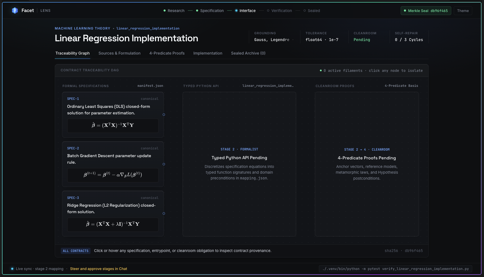
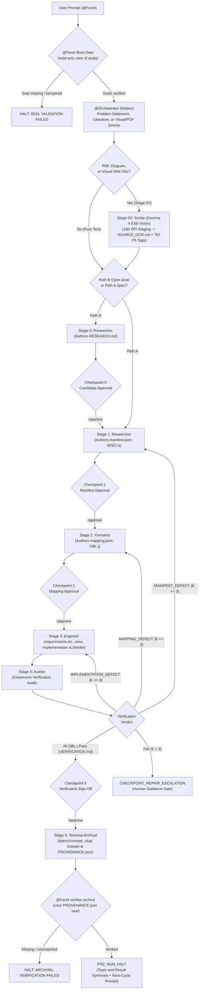

# Facet
v.Preview


SPECIFICATION-DRIVEN AI PIPELINE USING AN OLLAMA BACKEND AND THE GOOGLE GEMMA 4 MODEL SUITE IN VISUAL STUDIO CODE ON MACOS

## Abstract

Running smaller open-weight models for coding tasks can often be unreliable and brittle when a single model has to track its state, follow specs, edit files, and verify its own work all at once. **Facet** is an experimental pipeline for Visual Studio (VS) Code that addresses this by pairing deterministic GitHub Copilot lifecycle hooks with Google's Gemma 4 models running locally through Ollama on macOS. Instead of relying on open-ended prompting alone from start to finish, Facet breaks down the steps from technical documents, PDFs, or specifications to working Python code into focused, human-approved stages—assigning document reading, specification extraction, interface design, implementation, and auditing to separate role-matched models. This structure brings practical benefits for smaller local models run on consumer hardware. Models resist drift because each step has a narrow scope, deterministic hooks to catch formatting or type errors before they compound, and separating the coding agent from the auditing agent to prevent self-fulfilling tests. Candidate implementations are checked against concrete test vectors, reference behavior, invariants, and property-based tests agreed to prior to being engineered, with a bounded three-attempt repair loop if those conditions are repeatedly unmet. Everything runs locally without cloud APIs or external data sharing, and each completed run is archived with a verifiable record of its specs, code, and test results.



---

## Pipeline Overview

**Facet** translates ambiguous technical ideas, formal literature, continuous physical models, and RFC protocol specifications into mathematically verified code.

Rather than relying on unconstrained LLM code generation, Facet enforces **Stepwise Specification Refinement**, **Cleanroom Separation of Concerns**, and **Hughes's Complete 4-Predicate Verification Basis** through deterministic, fail-closed lifecycle hooks in Visual Studio Code.



---

## Core Innovations and Theoretical Grounding

1. **Stepwise Specification Refinement (Wirth 1971, Morgan 1990):**
   Translation proceeds through machine-checked intermediate representations (`SOURCE_OCR.md` [conditional] -> `RESEARCH.md` -> `manifest.json` [`SPEC-k`] -> `mapping.json` [`OBL-j`] -> Production Source Code -> `VERIFICATION.md`), where each specialist directly authors and seals its contained stage deliverable.

2. **Cleanroom Software Engineering (Mills, Dyer, and Linger, IEEE TSE 1987):**
   The implementation agent (`@Engineer`) and verification auditor (`@Auditor`) are structurally isolated by capability-confinement hooks. The Engineer cannot modify verification test suites, and the Auditor cannot modify production implementation code, preventing self-fulfilling test suites.

3. **Hughes's Complete 4-Predicate Verification Basis (Hughes 2019, Weyuker 1982):**
   Decouples verification from hardcoded algebra tools. Every specification claim `SPEC-k` lowers into one or more executable obligations (`OBL-j`):
   - `anchor`: Pinned literature input/output test vectors ($f(x_0) == y_0$).
   - `reference_model`: Observational equivalence against an unoptimized reference implementation on small domains (ALGO / Weyuker pseudo-oracle).
   - `relational_law`: Metamorphic multi-call identities ($f(T(x)) \sim g(f(x))$, round-trip serialization `decode(encode(m)) == m`, symmetry, conservation).
   - `postcondition`: Universal invariant checks and property-based fuzzing using Hypothesis.

4. **Vision/PDF Modality Firewall, TEI P5 Epistemic Provenance & Create-Once / Scoped-Edit Sandboxes:**
   All PDFs, diagrams, and web figures are isolated inside `@Scribe` (`gemma4:e4b` `~150M` Vision Encoder at `T=0.1, top_p=0.95, top_k=64` -> `SOURCE_OCR.md`) behind a hard `preToolUse` Modality Firewall protecting text-confined reasoning models. Degraded or occluded glyphs are marked with TEI P5 `<uncertain>` / `<illegible/>` XML provenance and deterministically propagated into `manifest.json` `ambiguities` and `"epistemic_status": "assumption"`, while Create-Once / Scoped-Edit sandboxes (`create` once with `.rollback_<name>` staging and RFC 8259 Gemma `<|"|>` JSON formatting, followed by minimal surgical `edit` / `code_patch.py` replacements) eliminate destructive whole-file rewrites and line-splice corruption.

5. **Bounded Reflexion Self-Repair, Artifact-Preserving Scoped Edits & System-1 Boundary Triage (Shinn et al., NeurIPS 2023):**
   Verification failures generate structured diagnostic records in `AUDIT_FEEDBACK.json` (preserved on disk across repairs and archived as `AUDIT_HISTORY.json` at Stage 5) while strictly blocking `VERIFICATION.md` if any `OBL-j` is `FAILED` or `CONDITIONAL_PASS`. All artifacts (`manifest.json`, `mapping.json`, `*.py`, `verify_*.py`) remain on disk for surgical RRSI `edit` / `code_patch.py` line replacements rather than destructive full-file rewrites, while a boundary-only System-1 decision model (`pplx-decider-flash`, `keep_alive=0` under `OLLAMA_MAX_LOADED_MODELS=1`) screens specs in `<1 s`, overrides mislabelled Stage-4 defect targets (`IMPLEMENTATION_DEFECT` vs. `MAPPING_DEFECT` vs. `MANIFEST_DEFECT`), and pools line-level probabilities over AST/JSON hunks (`Method L3`) to pass advisory `<edit_scope_hint>` windows to the repairing specialist before escalating to human review (`CHECKPOINT_REPAIR_ESCALATION`) at $K_{\max}=3$.

6. **Deterministic Fail-Closed Hooks, `AST-1..AST-4` Verification Gates & Compositional `specs/` Chaining:**
   A single, self-contained Python reference monitor (`pipeline_guards.py`) intercepts 12 Visual Studio Code Copilot lifecycle events to enforce finite state machine (FSM) gates, cryptographic write-locks on approved specifications, canonical specialist prompt envelopes (`<caller_interface_contract>` + advisory `<edit_scope_hint>`), and four cross-stage AST verification gates: **`AST-1`** (`formal_predicate` Python `eval` AST compilation + $O(N^3)$ decomposition ban in preconditions), **`AST-2`** (lexical-scope unbound-variable detection across closures and comprehensions), **`AST-3`** (blocking silent one-sided rational denominator bailouts in iterative solvers), and **`AST-4`** (caller module filename, exact positional parameter name, and `verify_*.py` entrypoint call parity)—alongside `variables[*].role` symbol parity, physical `unit` dimensional consistency, closed-book `allow_web_research: false` isolation, seal-verified `upstream_modules` cross-archive `PYTHONPATH` imports, incremental AST dependency-closure caching, semantic `knowledge.db` archive recall, and scope-aware dual-hook shadowing.

7. **Transient Read-Only Hypervisor (`@Facet`), Split-Plane Tamper-Evident Sealing & `Facet Lens` Canvas:**
   `@Facet` is the only user-visible agent. Restricted to a single read-only tool (`view`) plus internal `task(agent_type="Orchestrator", mode="sync", ...)`, it answers instant `/status` pulses and read-only Checkpoint Q&A, validates SHA-256 seals before the hidden `@Orchestrator` starts, steps out of memory while the larger models work, and returns after Stage 5 to verify the sealed `specs/<concept_slug>/PROVENANCE.json` (including the auto-generated `README.md` Engineering Dossier and `hook_state_snapshot.json`) and park the pipeline in `PRE_RUN_HALT` with a Topic-and-Result Synthesis and Cycle-2 `specs/<slug>/` prompt bridge. The always-on reference monitor (`pipeline_guards.py`, no VRAM) mirrors every seal into a tamper-evident out-of-workspace Shadow Seal Ledger so any in-workspace modification of both an artifact and its state hash is detected immediately, while the Workspace-scoped **Facet Lens** Copilot Canvas (`.github/extensions/facet-lens/`) renders live equations, `SPEC -> FN -> OBL` traceability, 4-predicate proofs, Reflexion counterexample diffs, and sealed archives at zero LLM token cost via instant loopback SSE notifications.

---

## Gemma 4 Model-to-Role Allocation Matrix

Facet allocates specialized Google DeepMind Gemma 4 models according to modality and cognitive architecture:

| Role | Blueprint File | Base Model | VRAM / Weights | Mode & Sampling | Cognitive Focus |
| :--- | :--- | :--- | :--- | :--- | :--- |
| **`@Researcher`**, **`@Formalist`**, **`@Engineer`** & **`@Auditor`** | `Modelfile.engineer-auditor` *(default)* / `Modelfile.{researcher,formalist}` | `gemma4:26b-a4b-it-q8_0` | ~28 GB (3.8B active) | System-2 (`T=1.0, p=0.95, k=64`) | High-speed unified MoE literature grounding (`RESEARCH.md` + `manifest.json`), discrete formalization (`mapping.json`), typed implementation (`requirements.txt` + `.venv`), and 4-predicate cleanroom verification (`VERIFICATION.md`) with zero `S1 -> S2 -> S3 -> S4` VRAM swap. |
| **`@Scribe`** | `Modelfile.e4b` *(default)* / `Modelfile.scribe` | `gemma4:e4b` | ~9.5 GB | Direct Vision (`T=0.1, p=0.95, k=64`) | Dedicated `~150M` Vision Encoder for upstream Stage 0V PDF/diagram/web-figure OCR into `SOURCE_OCR.md` with TEI P5 `<uncertain>`/`<illegible/>` provenance. |
| **`@Orchestrator`** *(hidden)* | `Modelfile.e4b` *(default)* / `Modelfile.orchestrator` | `gemma4:e4b` | ~9.5 GB | Direct Routing (`T=0.1, p=0.95, k=64`) | Low-variance `S0V + S0->S5` routing, FSM gate enforcement, and checkpoint briefs (`0.0s` VRAM swap with `@Facet` and `@Scribe`). |
| **`@Facet`** *(visible)* | `Modelfile.e4b` *(default)* / `Modelfile.facet` | `gemma4:e4b` | ~9.5 GB | Direct Gating (`T=0.1, p=0.95, k=64`) | Transient read-only hypervisor: boot-time seal validation, internal `@Orchestrator` invocation, post-archive verification, and `PRE_RUN_HALT` loop-back (`0.0s` swap, shares the warm E4B runner). |
| **System-1 Boundary Decider** *(hook-invoked)* | Native `/v1/systemone` (`keep_alive=0`) | `pplx-decider-flash` | ~5.6 GB (`0 B` persistent) | Calibrated `choice`/`noul` (`0` output tok) | Sub-second stage-boundary semantic spec screening (`tau=0.85`), Stage-4 diagnosis-vs-label override, and `Method L3` AST/JSON hunk edit-scope localization. |

*Hardware Concurrency & KV-Cache Invariant:* On Apple Silicon with 64GB unified memory, configure `OLLAMA_MAX_LOADED_MODELS=1`, `OLLAMA_FLASH_ATTENTION=1`, and `OLLAMA_KV_CACHE_TYPE=q8_0` (via `launchctl setenv` + restarting `Ollama.app` on macOS). `OLLAMA_MAX_LOADED_MODELS=1` enforces strict single-model residency (`loaded runners count=1`, zero co-residency) across `26b-a4b-it-q8_0` (~27.6 GB wired across all four reasoning specialists with zero `S1..S4` swap), `e4b` (9.4 GB), and boundary-only `pplx-decider-flash` (`keep_alive=0`, ~0.9 s one-shot load+unload), keeping the entire active weight set (`~37 GB`) warm inside the macOS unified page cache while `OLLAMA_KV_CACHE_TYPE=q8_0` cuts the GGUF `26b-a4b` 128K KV buffer by 45% (`2860 -> 1572.5 MiB`). `@Facet` deliberately shares `gemma4:e4b` with `@Orchestrator` and `@Scribe` (`0.0 s` handoff swap) instead of a persistent second model or `gemma4:e2b`; see [System Architecture](docs/architecture.md) for the measured memory analysis.

---

## Quickstart

### 1. Compile Ollama Models

Ensure Ollama is running, then pull base weights and compile the Facet Modelfiles:

```bash
ollama pull gemma4:26b-a4b-it-q8_0
ollama pull gemma4:e4b
ollama pull pplx-decider-flash

chmod +x modelfiles/build_modelfiles.sh
./modelfiles/build_modelfiles.sh
```

### 2. Choose Deployment Mode

#### Option A: As a Workspace Template (Recommended)
Clone Facet as a clean template for a new engineering project:

```bash
git clone https://github.com/division-labs/facet.git my-project
cd my-project
python3 -m venv .venv
./.venv/bin/pip install -r templates/domains/scientific-computing/requirements.txt
```

Open `my-project` in VS Code. All agents (`@Facet`, `@Orchestrator`, `@Researcher`, `@Formalist`, `@Engineer`, `@Auditor`, `@Scribe`), skills, and hooks are discovered automatically; only `@Facet` appears in the agent picker (`@Orchestrator` and the specialists are internal subagents).

#### Option B: Install at User Scope (`~/.copilot/`)
To use Facet across all your local repositories without copying `.github/` into each project:

```bash
# Preview actions without modifying disk
python3 scripts/install_user_level.py --dry-run

# Synchronize agents, skills, and hooks to ~/.copilot/
python3 scripts/install_user_level.py
```
*(User-configured `model:` identifiers in `~/.copilot/agents/*.agent.md` are automatically preserved).*

### 3. Run a Workflow in VS Code

Open the Copilot Chat panel (using the **Copilot** harness) and invoke `@Facet` against the bundled visual Quickstart input ([examples/magical_mystery/IMG_1598.jpg](examples/magical_mystery/IMG_1598.jpg)):

```text
@Facet What can you see through your crystalline lens if you peer into the examples folder about the magical mystery image?
```

`@Facet` verifies pre-flight cryptographic seals, dispatches `@Orchestrator` to locate the image and run Stage 0V `@Scribe` vision OCR (`SOURCE_OCR.md`), pauses at four human review gates (`RESEARCH.md` -> `manifest.json` -> `mapping.json` -> `VERIFICATION.md`, advancing only on `/approve`), and seals the verified Python implementation, test suite, and `PROVENANCE.json` inside `specs/<concept_slug>/` while leaving the workspace root clean.

Or launch a pure-text literature run without visual inputs:

```text
@Facet Implement and verify the classical Runge-Kutta 4th-order (RK4) ODE integrator from literature.
```

---

## Documentation Index

Comprehensive guides are organized under `docs/` using the Diataxis documentation architecture:

- [Installation Guide](docs/installation.md): Prerequisites, Ollama setup, Modelfiles compilation, workspace setup, and verification.
- [Usage and Workflow Guide](docs/usage-and-workflow.md): Walkthrough of Stage S0V and Stages S0 through S5, `/approve`, `/status`, `/reset`, and `/add-source` contracts, `Facet Lens` Canvas, and self-repair loops.
- [Customization Guide](docs/customization.md): Reparameterizing for other domains (RFC protocols, ML kernels, verified APIs), hardware targets, and toolchains.
- [System Architecture](docs/architecture.md): Deep theoretical specification of the 6-layer harness, the `@Facet` hypervisor, cleanroom isolation, and Merkle DAG provenance.
- [Schemas and Contracts](docs/reference/schemas-and-contracts.md): Specification for `manifest.json`, `mapping.json`, `AUDIT_FEEDBACK.json`, and `lint_rules.json`.
- [Hooks and Guards](docs/reference/hooks-and-guards.md): Hook events, capability confinement, write-locks, and CLI actions.
- [Benchmark Harness (`SciCode`)](benchmarks/README.md): Canonical `scicode-bench/SciCode` 3-arm local Ollama evaluation (`15/15` validation problems, `50/50` subproblems, `--preset quick`, and `--compare-runs`).
- [Changelog](CHANGELOG.md): Release notes and version history.

---

## Repository Structure

```
.
|-- .github/                     # Workspace-level Copilot customizations
|   |-- agents/                  # 7 personas: visible @Facet hypervisor + hidden @Orchestrator and 5 specialists
|   |-- extensions/facet-lens/   # Workspace-scoped Facet Lens Copilot Canvas workbench
|   |-- skills/                  # Domain skills (formal-mapping, verification-auditing, etc.)
|   |-- hooks/                   # Lifecycle hooks & pipeline_guards.py
|   `-- copilot-instructions.md  # Ambient engineering invariants
|-- benchmarks/                  # Canonical SciCode (scicode-bench/SciCode) 3-arm local Ollama benchmark
|-- docs/                        # Diataxis documentation suite
|   |-- README.md                # Documentation index
|   |-- installation.md          # Unified installation guide
|   |-- usage-and-workflow.md    # End-to-end lifecycle walkthrough
|   |-- customization.md         # Domain and toolchain adaptation
|   |-- architecture.md          # Formal theoretical specification
|   `-- reference/               # Schemas, contracts, and hook reference
|-- examples/                    # Reference inputs and deliverables
|   |-- magical_mystery/         # Visual Quickstart equation scan (Stage 0V -> Stage 5)
|   `-- mandelbrot_set/          # Complete Mandelbrot specification and mapping
|-- modelfiles/                  # Gemma 4 Ollama Modelfiles & build script
|-- scripts/                     # Installer and test suite
|-- specs/                       # Terminal archive directory for completed runs
|-- templates/                   # Domain presets, governance modes, and model profiles
|-- CHANGELOG.md                 # Release notes and version history
`-- LICENSE                      # Apache License 2.0
```

### Codebase Reading Guide (For First-Time Readers)

If you are exploring the source code for the first time, every component has a single, clear responsibility:
1. **[.github/hooks/scripts/pipeline_guards.py](.github/hooks/scripts/pipeline_guards.py) (Enforcement Plane):** A zero-VRAM, standard-library Python reference monitor invoked automatically by VS Code Copilot before and after every model turn and tool call. It enforces stage gates, SHA-256 seals, AST/JSON validation, and scoped-edit rules so smaller local models cannot skip steps or corrupt files.
2. **[.github/agents/](.github/agents/) & [.github/skills/](.github/skills/) (Control & Specialist Planes):** Markdown role definitions and progressive-disclosure skill packages (`schema.json`, `mapping_schema.json`, `audit_feedback_schema.json`, [prepare_visual_sources.py](.github/skills/technical-perception/scripts/prepare_visual_sources.py) for 180 DPI visual staging, and [code_patch.py](.github/skills/implementation-engineering/scripts/code_patch.py) for AST/JSON surgical patching).
3. **[.github/extensions/facet-lens/](.github/extensions/facet-lens/) (Visual Companion):** A pure ES-module Copilot Canvas web app (`extension.mjs`, `server.mjs`, `state.mjs`, `ui.mjs`) that watches workspace state on `127.0.0.1` over Server-Sent Events (SSE) and renders live equations, `SPEC -> FN -> OBL` graphs, and proof results with zero LLM token overhead.
4. **[modelfiles/](modelfiles/) & [templates/](templates/) (Local Model & Domain Configuration):** Clean-stop Ollama Modelfile blueprints (`build_modelfiles.sh`), governance presets (`strict-4-gate`, `streamlined-2-gate`, `autonomous-batch`), hardware profiles, and optional `EmbeddingGemma 2` vector indexing ([post_archive_embed.py](templates/extensions/post_archive_embed.py)).
5. **[scripts/validate_system.py](scripts/validate_system.py) & [benchmarks/run_benchmark.py](benchmarks/run_benchmark.py) (Verification & Benchmarking):** End-to-end 5-pathway self-validation suite and the canonical 3-arm `SciCode` benchmark runner.

---

## Academic References

- **Mills, H. D., Dyer, M., & Linger, R. C. (1987).** *Cleanroom Software Engineering.* IEEE Transactions on Software Engineering, SE-13(9), 1027-1037.
- **Wirth, N. (1971).** *Program Development by Stepwise Refinement.* Communications of the ACM, 14(4), 221-227.
- **Hughes, J. (2019).** *How to Specify it! A Guide to Writing Properties of Pure Functions.* Trends in Functional Programming in Education (TFPIE 2019).
- **Weyuker, E. J. (1982).** *On Testing Non-testable Programs.* The Computer Journal, 25(4), 465-470.
- **Shinn, N., Cassano, F., Gopinath, A., Narasimhan, K., & Yao, S. (2023).** *Reflexion: Language Agents with Verbal Reinforcement Learning.* NeurIPS 2023.
- **Hong, S., et al. (2024).** *MetaGPT: Meta Programming for A Multi-Agent Collaborative Framework.* ICLR 2024.
- **Yao, S., et al. (2023).** *ReAct: Synergizing Reasoning and Acting in Language Models.* ICLR 2023.

---

## License

Apache License 2.0. See [LICENSE](LICENSE) for details.
