# Facet
v.Preview


SPECIFICATION-DRIVEN AI PIPELINE USING AN OLLAMA BACKEND AND THE GOOGLE GEMMA 4 MODEL SUITE IN VISUAL STUDIO CODE ON MACOS

## Abstract

Running smaller open-weight models on complex coding tasks can be unreliable and brittle when a single model has to interpret source documents, track workflow state, design interfaces, edit files, and verify its own work in one pass. **Facet** is an experimental engineering pipeline for Visual Studio Code that addresses this by pairing deterministic GitHub Copilot lifecycle hooks with Google's Gemma 4 models running locally through Ollama on macOS. Instead of relying on open-ended prompting from start to finish, Facet breaks down technical papers, PDFs, or specifications into working Python modules through focused, human-approved stages—assigning document transcription, specification extraction, interface and obligation design, implementation, and verification auditing to separate role-matched models. This structure brings practical benefits for smaller local models running on consumer hardware. Models resist drift because each stage has a narrow contract, deterministic hooks catch formatting, schema, and type errors before they compound, and cleanroom boundaries isolate the coding agent from the auditing agent so verification suites are authored blind to implementation internals rather than becoming self-fulfilling. Candidate implementations are tested against concrete anchor vectors, reference models, relational invariants, or property-based fuzzing defined before any code is written, with a bounded three-attempt self-repair loop that routes failures back to the responsible code or specification stage before escalating to human review. Everything runs locally and each completed run is sealed into an archive with provenance hashes linking its specifications, code, and test proofs.


---

## Pipeline Overview

**Facet** translates ambiguous technical ideas, formal literature, continuous physical models, and RFC protocol specifications into mathematically verified code. Rather than relying on unconstrained LLM code generation, Facet structures translation through **Stepwise Specification Refinement** ([Wirth, 1971](https://doi.org/10.1145/362575.362577); [Morgan, 1994](#academic-references)), **Two-Phase Cleanroom Isolation & Confinement** drawing on [Mills, Dyer, and Linger (1987)](https://doi.org/10.1109/MS.1987.231413) and [Lampson (1973)](https://doi.org/10.1145/362375.362389), a **Four-Predicate Verification Taxonomy** grounded in property-based specification ([Claessen & Hughes, 2000](https://doi.org/10.1145/351240.351266); [Hughes, 2020](https://doi.org/10.1007/978-3-030-47147-7_4)), pseudo-oracle differential testing ([Weyuker, 1982](https://doi.org/10.1093/comjnl/25.4.465); [McKeeman, 1998](#academic-references)), and metamorphic relations ([Chen et al., 1998](https://arxiv.org/abs/2002.12543)), and a **Finite-State Reference Monitor** ([Anderson, 1972](#academic-references); [Schneider, 2000](https://doi.org/10.1145/353323.353382)) enforced deterministically by Visual Studio Code lifecycle hooks.

```mermaid
flowchart TD
    User["User Prompt (@Facet)"] --> Boot{"@Facet Boot Gate<br/>(read-only view of seals)"}
    Boot -- "Seal missing / tampered" --> HaltSeal["HALT: SEAL VALIDATION FAILED"]
    Boot -- "Seals verified" --> Start["@Orchestrator (hidden)<br/>Problem Statement, Literature, or Visual/PDF Source"]
    Start --> VCheck{"PDF, Diagram,<br/>or Visual Web Doc?"}
    VCheck -- "Yes (Stage 0V)" --> S0V["Stage 0V: Scribe (Gemma 4 E4B Vision)<br/>(Lossless 200 DPI PNG + Vector Glyph Anchors -> SOURCE_OCR.md)"]
    VCheck -- "No (Pure Text)" --> Route{"Path B Open Goal<br/>or Path A Spec?"}
    S0V --> Route
    Route -- "Path B" --> S0["Stage 0: Researcher<br/>(Authors RESEARCH.md)"]
    S0 --> C0{"Checkpoint 0<br/>Candidate Approval"}
    C0 -- "/approve" --> S1["Stage 1: Researcher (+ 1-Pass Executable Critic)<br/>(Authors manifest.json: SPEC-k)"]
    Route -- "Path A" --> S1
    S1 --> C1{"Checkpoint 1<br/>Manifest Approval"}
    C1 -- "/approve" --> S2["Stage 2: Formalist<br/>(Hydrated manifest -> mapping.json: OBL-j)"]
    S2 --> C2{"Checkpoint 2<br/>Mapping Approval"}
    C2 -- "/approve" --> S3["Stage 3: Engineer<br/>(Cleanroom-Redacted mapping -> .venv, *.py & Smoke)"]
    S3 --> S4["Stage 4: Auditor<br/>(Two-Phase Cleanroom Audit: Stub Pre-Pytest)"]
    S4 --> Verdict{"Verification<br/>Verdict"}

    Verdict -- "IMPLEMENTATION_DEFECT (K <= 3)" --> S3
    Verdict -- "MAPPING_DEFECT (K <= 3)" --> S2
    Verdict -- "MANIFEST_DEFECT (K <= 3)" --> S1

    Verdict -- "All OBL-j Pass (VERIFICATION.md)" --> C3{"Checkpoint 3<br/>Verification Sign-Off"}
    C3 -- "/approve" --> S5["Stage 5: Terminal Archival<br/>(specs/concept_slug/ Dossier & PROVENANCE.json)"]
    S5 --> Verify{"@Facet verifies archive<br/>(view PROVENANCE.json seal)"}
    Verify -- "Missing / mismatched" --> HaltArch["HALT: ARCHIVAL VERIFICATION FAILED"]
    Verify -- "Verified" --> PreRun["PRE_RUN_HALT<br/>(Topic-and-Result Synthesis + Next-Cycle Prompt)"]

    Verdict -- "Fail (K > 3)" --> Escalation["CHECKPOINT_REPAIR_ESCALATION<br/>(Human Guidance Gate)"]
```



---

## Core Innovations and Theoretical Grounding

1. **Stepwise Specification Refinement ([Wirth, 1971](https://doi.org/10.1145/362575.362577); [Morgan, 1994](#academic-references)):**
   Translation proceeds through machine-checked intermediate representations (`SOURCE_OCR.md` [conditional] -> `RESEARCH.md` -> `manifest.json` [`SPEC-k`] -> `mapping.json` [`OBL-j`] -> Production Source Code -> `VERIFICATION.md`), where each specialist directly authors and seals its stage deliverable before the next stage begins.

2. **Two-Phase Cleanroom Isolation & Information Confinement ([Mills, Dyer, & Linger, 1987](https://doi.org/10.1109/MS.1987.231413); [Lampson, 1973](https://doi.org/10.1145/362375.362389)):**
   Drawing on Cleanroom software engineering's separation between code construction and certification ([Mills, Dyer, & Linger, 1987](https://doi.org/10.1109/MS.1987.231413)) and Lampson's channel-confinement criteria ([Lampson, 1973](https://doi.org/10.1145/362375.362389)), Facet isolates the implementation agent (`@Engineer`) from the verification auditor (`@Auditor`) through symmetrical capability-confinement hooks while tailoring execution rules to local models. `@Engineer` receives `mapping.json` with `anchor_test_cases` and `expected` values redacted (`s2_s3_selective_hydration`), may run up to three inline smoke probes on its own module, and cannot read or execute verification suites. `@Auditor` authors `verify_*.py` blind to `<target_module>.py` from AST public signature stubs (`<hydrated_public_surface>`), unlocking read-only source inspection under `two_phase_post_pytest` only after a failing `pytest` run so counterexample triage stays grounded without making initial test design self-fulfilling.

3. **Four-Predicate Verification Taxonomy ([Claessen & Hughes, 2000](https://doi.org/10.1145/351240.351266); [Hughes, 2020](https://doi.org/10.1007/978-3-030-47147-7_4); [Weyuker, 1982](https://doi.org/10.1093/comjnl/25.4.465); [Chen et al., 1998](https://arxiv.org/abs/2002.12543)):**
   Decouples verification from any single symbolic algebra tool by lowering every specification claim `SPEC-k` into executable obligations (`OBL-j`) across four complementary test families:
   - `anchor`: Pinned literature input/output vectors and singular boundary checks ($f(x_0) \approx y_0$).
   - `reference_model`: Pseudo-oracle differential testing against a direct, unoptimized reference implementation on small domains ([Weyuker, 1982](https://doi.org/10.1093/comjnl/25.4.465); [McKeeman, 1998](#academic-references); [Zhang et al., 2023](https://arxiv.org/abs/2305.14591)).
   - `relational_law`: Multi-call metamorphic and round-trip identities ($f(T(x)) \sim g(f(x))$, `decode(encode(m)) == m`, symmetry, conservation; [Chen et al., 1998](https://arxiv.org/abs/2002.12543); [Hughes, 2020](https://doi.org/10.1007/978-3-030-47147-7_4)).
   - `postcondition`: Universal invariant checks, Design-by-Contract boundary assertions ([Meyer, 1992](https://doi.org/10.1109/2.161279)), and randomized counterexample shrinking via Hypothesis ([MacIver et al., 2019](https://doi.org/10.21105/joss.01891)).

4. **Vision/PDF Modality Firewall, Transcriptional Uncertainty Markup ([TEI P5 Ch. 12](https://tei-c.org/release/doc/tei-p5-doc/en/html/PH.html#PHDA)) & Scoped-Edit Sandboxes:**
   All PDFs, diagrams, and web figures are isolated inside `@Scribe` (`gemma4:e4b` `~150M` Vision Encoder at `T=0.1` -> `SOURCE_OCR.md`) behind a hard `preToolUse` Modality Firewall, pairing lossless `200 DPI` PNG plates with per-plate `CGPDFScanner` math-glyph `<vector_glyph_anchor>` hints while keeping embedded `SOURCE_TEXT.md` prose separate. Adapting the `<unclear>` and `<gap>` editorial markup conventions of the Text Encoding Initiative ([TEI P5 §3.5.3 & Ch. 12](https://tei-c.org/release/doc/tei-p5-doc/en/html/PH.html#PHDA)), degraded or occluded glyphs are recorded with a compact two-element XML vocabulary (`<uncertain>` and `<illegible/>`) and propagated into `manifest.json` `ambiguities` and `"epistemic_status": "assumption"`, while source-backed multi-equation manifests undergo a single-pass executable toy-vector audit (`enable_local_spec_critic = "s1_only"`) before Checkpoint 1 seals. Create-Once / Scoped-Edit sandboxes (`create` once with `.rollback_<name>` staging and [RFC 8259](https://www.rfc-editor.org/rfc/rfc8259) JSON formatting, followed by surgical `edit` / `code_patch.py` replacements) prevent whole-file rewrite drift.

5. **Execution-Guided Self-Repair & Bidirectional Contract Rewinds ([Shinn et al., 2023](https://arxiv.org/abs/2303.11366); [Chen et al., 2024](https://arxiv.org/abs/2304.05128)):**
   Building on verbal reinforcement learning ([Shinn et al., 2023](https://arxiv.org/abs/2303.11366)) and unit-test-driven self-debugging ([Chen et al., 2024](https://arxiv.org/abs/2304.05128)) while replacing free-form reflection prose with schema-checked diagnostics, verification failures record minimal counterexamples and defect classifications in `AUDIT_FEEDBACK.json` (archived as `AUDIT_HISTORY.json` at Stage 5) and block `VERIFICATION.md` whenever any `OBL-j` fails. Workspace artifacts remain on disk for surgical `edit` / `code_patch.py` patches, and both `@Auditor` (Stage 4) and `@Engineer` (Stage 3, within its `3/3` smoke-probe budget) can trigger target-aware upstream rewinds (`IMPLEMENTATION_DEFECT -> S3`, `MAPPING_DEFECT -> S2`, `MANIFEST_DEFECT -> S1`) up to $K_{\max}=3$ before escalating to human review (`CHECKPOINT_REPAIR_ESCALATION`). When `"system1_s1_s2"` is enabled, a boundary System-1 model (`pplx-decider-flash`, `keep_alive=0`) provides sub-second semantic screening and `Method L3` line-scope hints.

6. **Deterministic Reference Monitor & Security-Automaton Hooks ([Anderson, 1972](#academic-references); [Schneider, 2000](https://doi.org/10.1145/353323.353382)):**
   A zero-VRAM, standard-library Python reference monitor (`pipeline_guards.py` facade backed by the 9-layer acyclic `facet_guards/` package, decomposed along [Parnas, 1972](https://doi.org/10.1145/361598.361623) information-hiding boundaries) intercepts 13 Visual Studio Code Copilot lifecycle events as a finite-state security automaton ([Schneider, 2000](https://doi.org/10.1145/353323.353382)) to enforce FSM stage gates, SHA-256 write-locks on approved specifications, stage-bounded context isolation (conditioning Stage 1 solely on the approved `RESEARCH.md` dossier so raw upstream transcripts are not re-ingested), format-symmetric and comment-tolerant `edit` auto-snapping (`stage3d_ruff_comment_strip`), verbatim `type_mappings[*].symbol` foreign-key coverage (preserving idiomatic Python parameter names), `<0.4 s` synthesized-stub `mypy` call-composition checks at Stage 2, and deterministic `AST-1..AST-4` gates—alongside seal-verified `upstream_modules` cross-archive `PYTHONPATH` imports and semantic `knowledge.db` archive recall.

7. **Transient Read-Only Hypervisor (`@Facet`), Split-Plane Tamper-Evident Sealing & `Facet Lens` Canvas:**
   `@Facet` is the only user-visible agent. Restricted to a single read-only tool (`view`) plus internal `task(agent_type="Orchestrator", mode="sync", ...)`, it answers instant `/status` pulses and read-only Checkpoint Q&A, validates SHA-256 seals before the hidden `@Orchestrator` starts, steps out of memory while the larger models work, and returns after Stage 5 to verify the sealed `specs/<concept_slug>/PROVENANCE.json` (including the auto-generated `README.md` Engineering Dossier and `hook_state_snapshot.json`) and park the pipeline in `PRE_RUN_HALT` with a Topic-and-Result Synthesis and Cycle-2 `specs/<slug>/` prompt bridge. The always-on reference monitor (`pipeline_guards.py`, no VRAM) mirrors every seal into a tamper-evident out-of-workspace Shadow Seal Ledger so any in-workspace modification of both an artifact and its state hash is detected immediately, while the Workspace-scoped **Facet Lens** Copilot Canvas (`.github/extensions/facet-lens/`) renders live equations, `SPEC -> FN -> OBL` traceability, 4-predicate proofs, Reflexion counterexample diffs, and sealed archives at zero LLM token cost via instant loopback SSE notifications.

---

## Gemma 4 Model-to-Role Allocation Matrix

Facet allocates specialized Google DeepMind Gemma 4 models according to modality and cognitive architecture:

| Role | Blueprint File | Base Model | VRAM / Weights | Mode & Sampling | Cognitive Focus |
| :--- | :--- | :--- | :--- | :--- | :--- |
| **`@Researcher`**, **`@Formalist`**, **`@Engineer`** & **`@Auditor`** | `Modelfile.engineer-auditor` *(default)* / `Modelfile.{researcher,formalist}` | `gemma4:26b-a4b-it-q8_0` | ~28 GB (3.8B active) | System-2 (`T=1.0, p=0.95, k=64`) | High-speed unified MoE literature grounding (`RESEARCH.md` + `manifest.json`), discrete formalization (`mapping.json`), typed implementation (`requirements.txt` + `.venv`), and 4-predicate cleanroom verification (`VERIFICATION.md`) with zero `S1 -> S2 -> S3 -> S4` VRAM swap. |
| **`@Scribe`** | `Modelfile.e4b` *(default)* / `Modelfile.scribe` | `gemma4:e4b` | ~9.5 GB | Direct Vision (`T=0.1, p=0.95, k=64`) | Dedicated `~150M` Vision Encoder for upstream Stage 0V PDF/diagram/web-figure OCR into `SOURCE_OCR.md` with TEI P5 `<uncertain>`/`<illegible/>` provenance. |
| **`@Orchestrator`** *(hidden)* | `Modelfile.e4b` *(default)* / `Modelfile.orchestrator` | `gemma4:e4b` | ~9.5 GB | Direct Routing (`T=0.1, p=0.95, k=64`) | Low-variance `S0V + S0->S5` routing, FSM gate enforcement, and checkpoint briefs (`0.0s` VRAM swap with `@Facet` and `@Scribe`). |
| **`@Facet`** *(visible)* | `Modelfile.e4b` *(default)* / `Modelfile.facet` | `gemma4:e4b` | ~9.5 GB | Direct Gating (`T=0.1, p=0.95, k=64`) | Transient read-only hypervisor: boot-time seal validation, internal `@Orchestrator` invocation, post-archive verification, and `PRE_RUN_HALT` loop-back (`0.0s` swap, shares the warm E4B runner). |
| **System-1 Boundary Decider** *(hook-invoked)* | Native `/v1/systemone` (`keep_alive=0`, `ast_risk_gated`) | `pplx-decider-flash` | ~5.6 GB (`0 B` persistent) | Calibrated `choice`/`noul` (`0` output tok) | AST-risk-gated `<1 s` semantic spec screening (`tau=0.85`, `0` loads on clean specs), Stage-4 diagnosis-vs-label override, and `Method L3` AST/JSON hunk edit-scope localization. |

*Hardware Concurrency & KV-Cache Invariant:* On Apple Silicon with 64GB unified memory, configure `OLLAMA_MAX_LOADED_MODELS=1`, `OLLAMA_FLASH_ATTENTION=1`, and `OLLAMA_KV_CACHE_TYPE=q8_0` (via `launchctl setenv` + restarting `Ollama.app` on macOS). `OLLAMA_MAX_LOADED_MODELS=1` enforces strict single-model residency (`loaded runners count=1`, zero decision-model co-residency via `keep_alive=0`) across `26b-a4b-it-q8_0` (~27.6 GB wired across all four reasoning specialists with zero `S1..S4` swap), `e4b` (9.4 GB), and AST-risk-gated `pplx-decider-flash` (`keep_alive=0`, invoked only when deterministic risk signals fire or on Stage 4 rewinds, keeping 4-substep model-load overhead to `~6.9 s`), while `OLLAMA_KV_CACHE_TYPE=q8_0` cuts the GGUF `26b-a4b` 128K KV buffer by 45% (`2860 -> 1572.5 MiB`). `@Facet` deliberately shares `gemma4:e4b` with `@Orchestrator` and `@Scribe` (`0.0 s` handoff swap) instead of a persistent second model or `gemma4:e2b`; see [System Architecture](docs/architecture.md) for the measured memory analysis.

---

## Quickstart

### 1. Compile Ollama Models

Ensure Ollama is running, then pull base weights and compile the Facet Modelfiles:

```bash
ollama pull gemma4:26b-a4b-it-q8_0
ollama pull gemma4:e4b
ollama pull pplx-decider-flash

chmod +x modelfiles/build_modelfiles.sh
./modelfiles/build_modelfiles.sh
```

### 2. Choose Deployment Mode

#### Option A: As a Workspace Template (Recommended)
Clone Facet as a clean template for a new engineering project:

```bash
git clone https://github.com/division-labs/facet.git my-project
cd my-project
python3 -m venv .venv
./.venv/bin/pip install -r templates/domains/scientific-computing/requirements.txt
```

Open `my-project` in VS Code. All agents (`@Facet`, `@Orchestrator`, `@Researcher`, `@Formalist`, `@Engineer`, `@Auditor`, `@Scribe`), skills, and hooks are discovered automatically; only `@Facet` appears in the agent picker (`@Orchestrator` and the specialists are internal subagents).

#### Option B: Install at User Scope (`~/.copilot/`)
To use Facet across all your local repositories without copying `.github/` into each project:

```bash
# Preview actions without modifying disk
python3 scripts/install_user_level.py --dry-run

# Synchronize agents, skills, and hooks to ~/.copilot/
python3 scripts/install_user_level.py
```
*(User-configured `model:` identifiers in `~/.copilot/agents/*.agent.md` are automatically preserved).*

### 3. Run a Workflow in VS Code

Facet auto-scans `<workspace>/research/` (gitignored) as its default local corpus folder so bundled repository assets are never ingested into unrelated runs, while also promoting any workspace asset or `examples/` subfolder you explicitly name in your prompt (`dual_tier_explicit_promotion`). Invoke `@Facet` directly in the Copilot Chat panel on the bundled visual Quickstart photograph ([examples/magical_mystery/IMG_1598.jpg](examples/magical_mystery/IMG_1598.jpg)):

```text
@Facet What can you see through your crystalline lens if you peer into the examples folder about the magical mystery image?
```

*(For multi-file local corpora on your own projects, drop PDFs, scans, or reference notes into `<workspace>/research/`).*

`@Facet` verifies pre-flight cryptographic seals, dispatches `@Orchestrator` to run Stage 0V `@Scribe` vision OCR (`SOURCE_OCR.md`) on `examples/magical_mystery/IMG_1598.jpg`, pauses at four human review gates (`RESEARCH.md` -> `manifest.json` -> `mapping.json` -> `VERIFICATION.md`, advancing only on `/approve`), and seals the verified Python implementation, test suite, and `PROVENANCE.json` inside `specs/<concept_slug>/` while leaving the workspace root clean.

Or launch a pure-text literature run without visual inputs:

```text
@Facet Implement and verify the classical Runge-Kutta 4th-order (RK4) ODE integrator from literature.
```

---

## Documentation Index

Comprehensive guides are organized under `docs/` using the Diataxis documentation architecture:

- [Installation Guide](docs/installation.md): Prerequisites, Ollama setup, Modelfiles compilation, workspace setup, and verification.
- [Usage and Workflow Guide](docs/usage-and-workflow.md): Walkthrough of Stage S0V and Stages S0 through S5, `/approve`, `/status`, `/reset`, and `/add-source` contracts, `Facet Lens` Canvas, and self-repair loops.
- [Customization Guide](docs/customization.md): Reparameterizing for other domains (RFC protocols, ML kernels, verified APIs), hardware targets, and toolchains.
- [System Architecture](docs/architecture.md): Theoretical foundations, the 6-layer harness, two-phase Cleanroom isolation, four-predicate verification, the `@Facet` hypervisor, and SHA-256 provenance sealing.
- [Empirical Engineering & Contributor Guide](docs/empirical-engineering.md): How to diagnose 1:1 session traces, run zero-repo-mutation multi-modality A/B scratch batteries with interaction checks, maintain `Function Map` hygiene, and certify held-out changes.
- [Schemas and Contracts](docs/reference/schemas-and-contracts.md): Specification for `manifest.json`, `mapping.json`, `AUDIT_FEEDBACK.json`, and `lint_rules.json`.
- [Hooks and Guards](docs/reference/hooks-and-guards.md): Hook events, capability confinement, write-locks, and CLI actions.
- [Benchmark Harness (`SciCode`)](benchmarks/README.md): Canonical `scicode-bench/SciCode` 3-arm local Ollama evaluation (`15/15` validation problems, `50/50` subproblems, `--preset quick`, and `--compare-runs`).
- [Roadmap (`Mosaic` Workbench)](ROADMAP.md): Planned `Mosaic` compositional network browser, community convex hulls, multi-layer expand/collapse faces, and boundary-port `Composer` milestones.
- [Changelog](CHANGELOG.md): Release notes.

---

## Repository Structure

```
.
|-- .github/                     # Workspace-level Copilot customizations
|   |-- agents/                  # 7 personas: visible @Facet hypervisor + hidden @Orchestrator and 5 specialists
|   |-- extensions/facet-lens/   # Workspace-scoped Facet Lens Copilot Canvas workbench
|   |-- skills/                  # Domain skills (formal-mapping, verification-auditing, etc.)
|   |-- hooks/                   # Lifecycle hooks, pipeline_guards.py facade & 9-layer facet_guards/ package
|   `-- copilot-instructions.md  # Ambient engineering invariants
|-- benchmarks/                  # Canonical SciCode (scicode-bench/SciCode) 3-arm local Ollama benchmark
|-- docs/                        # Diataxis documentation suite
|   |-- README.md                # Documentation index
|   |-- installation.md          # Unified installation guide
|   |-- usage-and-workflow.md    # End-to-end lifecycle walkthrough
|   |-- customization.md         # Domain and toolchain adaptation
|   |-- architecture.md          # System architecture & theoretical foundations
|   |-- empirical-engineering.md # Contributor guide: trace forensics & A/B batteries
|   `-- reference/               # Schemas, contracts, and hook reference
|-- examples/                    # Reference inputs and deliverables
|   |-- magical_mystery/         # Visual Quickstart equation scan (Stage 0V -> Stage 5)
|   |-- constant_q_transform/    # Multi-page CC BY 4.0 PDF paper (Stage 0V -> Stage 5)
|   `-- mandelbrot_set/          # Complete Mandelbrot specification and mapping
|-- modelfiles/                  # Gemma 4 Ollama Modelfiles & build script
|-- scripts/                     # Installer, 1:1 SDK runner, trace analyzer, and validation suite
|-- specs/                       # Terminal archive directory for completed runs
|-- templates/                   # Domain presets, governance modes, and model profiles
|-- CHANGELOG.md                 # Initial preview release notes
|-- LICENSE                      # Apache License 2.0
`-- ROADMAP.md                   # Mosaic compositional workbench roadmap
```

### Codebase Reading Guide (For First-Time Readers)

If you are exploring the source code for the first time, every component has a single, clear responsibility:
1. **[.github/hooks/scripts/pipeline_guards.py](.github/hooks/scripts/pipeline_guards.py) & [.github/hooks/scripts/facet_guards/](.github/hooks/scripts/facet_guards/) (Enforcement Plane):** A zero-VRAM, standard-library Python reference monitor (organized as a 9-layer acyclic module DAG with top-of-file `Function Map:` indexes and `Section N:` anchors) invoked automatically by VS Code Copilot before and after every model turn and tool call. It enforces stage gates, SHA-256 seals, AST/JSON validation, format-symmetric `edit` auto-snapping, and Cleanroom isolation so local models cannot skip steps or corrupt files.
2. **[.github/agents/](.github/agents/) & [.github/skills/](.github/skills/) (Control & Specialist Planes):** Markdown role definitions and progressive-disclosure skill packages (`schema.json`, `mapping_schema.json`, `audit_feedback_schema.json`, [prepare_visual_sources.py](.github/skills/technical-perception/scripts/prepare_visual_sources.py) for `200 DPI` visual plate staging and deterministic `CGPDFScanner` PDF text extraction, and [code_patch.py](.github/skills/implementation-engineering/scripts/code_patch.py) for AST/JSON surgical patching).
3. **[.github/extensions/facet-lens/](.github/extensions/facet-lens/) (Visual Companion):** A pure ES-module Copilot Canvas web app (`extension.mjs`, `server.mjs`, `state.mjs`, `ui.mjs`) that watches workspace state (including live per-plate Stage 0V transcripts) on `127.0.0.1` over Server-Sent Events (SSE) and renders live equations, `SPEC -> FN -> OBL` graphs, and proof results with zero LLM token overhead.
4. **[modelfiles/](modelfiles/) & [templates/](templates/) (Local Model & Domain Configuration):** Clean-stop Ollama Modelfile blueprints (`build_modelfiles.sh`), governance presets (`strict-4-gate`, `streamlined-2-gate`, `autonomous-batch`), hardware profiles, and optional `EmbeddingGemma 2` vector indexing ([post_archive_embed.py](templates/extensions/post_archive_embed.py)).
5. **[scripts/README.md](scripts/README.md) ([copilot_sdk_runner.mjs](scripts/copilot_sdk_runner.mjs), [validate_system.py](scripts/validate_system.py), [analyze_trace.py](scripts/analyze_trace.py)) & [benchmarks/run_benchmark.py](benchmarks/run_benchmark.py) (Runtime Spine, Verification, Diagnostics & Benchmarking):** Shared 1:1 `copilot-runtime` + loopback wire-tap runner, 5-pathway self-validation suite, 1:1 stage-context bundler & 5-modality scorecard analyzer, and the canonical 3-arm `SciCode` benchmark runner.

---

## Academic References

- **Anderson, J. P. (1972).** *Computer Security Technology Planning Study.* Technical Report ESD-TR-73-51, Electronic Systems Division, U.S. Air Force Systems Command.
- **Schneider, F. B. (2000).** *Enforceable Security Policies.* ACM Transactions on Information and System Security, 3(1), 30-50. https://doi.org/10.1145/353323.353382
- **Lampson, B. W. (1973).** *A Note on the Confinement Problem.* Communications of the ACM, 16(10), 613-615. https://doi.org/10.1145/362375.362389
- **Merkle, R. C. (1987).** *A Digital Signature Based on a Conventional Encryption Function.* Advances in Cryptology — CRYPTO '87, LNCS 293, 369-378. https://doi.org/10.1007/3-540-48184-2_32
- **Laurie, B., Langley, A., & Kasper, E. (2013).** *Certificate Transparency* (RFC 6962, §2.1 Merkle Hash Trees). IETF. https://www.rfc-editor.org/rfc/rfc6962
- **Mills, H. D., Dyer, M., & Linger, R. C. (1987).** *Cleanroom Software Engineering.* IEEE Software, 4(5), 19-25. https://doi.org/10.1109/MS.1987.231413
- **Wirth, N. (1971).** *Program Development by Stepwise Refinement.* Communications of the ACM, 14(4), 221-227. https://doi.org/10.1145/362575.362577
- **Morgan, C. (1994).** *Programming from Specifications* (2nd ed.). Prentice Hall International Series in Computer Science.
- **Meyer, B. (1992).** *Applying "Design by Contract."* IEEE Computer, 25(10), 40-51. https://doi.org/10.1109/2.161279
- **Parnas, D. L. (1972).** *On the Criteria To Be Used in Decomposing Systems into Modules.* Communications of the ACM, 15(12), 1053-1058. https://doi.org/10.1145/361598.361623
- **Claessen, K., & Hughes, J. (2000).** *QuickCheck: A Lightweight Tool for Random Testing of Haskell Programs.* Proceedings of the Fifth ACM SIGPLAN International Conference on Functional Programming (ICFP '00), 268-279. https://doi.org/10.1145/351240.351266
- **Hughes, J. (2020).** *How to Specify It! A Guide to Writing Properties of Pure Functions.* Trends in Functional Programming (TFP 2019), LNCS 12053, 58-83. https://doi.org/10.1007/978-3-030-47147-7_4
- **MacIver, D. R., Hatfield-Dodds, Z., & Contributors. (2019).** *Hypothesis: A New Approach to Property-Based Testing.* Journal of Open Source Software, 4(43), 1891. https://doi.org/10.21105/joss.01891
- **Weyuker, E. J. (1982).** *On Testing Non-Testable Programs.* The Computer Journal, 25(4), 465-470. https://doi.org/10.1093/comjnl/25.4.465
- **McKeeman, W. M. (1998).** *Differential Testing for Software.* Digital Technical Journal, 10(1), 100-107.
- **Chen, T. Y., Cheung, S. C., & Yiu, S. M. (1998).** *Metamorphic Testing: A New Approach for Generating Next Test Cases.* Technical Report HKUST-CS98-01, Hong Kong University of Science and Technology (reprinted arXiv:2002.12543, https://arxiv.org/abs/2002.12543).
- **Zhang, K., Wang, D., Xia, J., Wang, W. Y., & Li, L. (2023).** *ALGO: Synthesizing Algorithmic Programs with LLM-Generated Oracle Verifiers.* NeurIPS 2023. https://arxiv.org/abs/2305.14591
- **Shinn, N., Cassano, F., Berman, E., Gopinath, A., Narasimhan, K., & Yao, S. (2023).** *Reflexion: Language Agents with Verbal Reinforcement Learning.* NeurIPS 2023. https://arxiv.org/abs/2303.11366
- **Chen, X., Lin, M., Schärli, N., & Zhou, D. (2024).** *Teaching Large Language Models to Self-Debug.* ICLR 2024. https://arxiv.org/abs/2304.05128
- **TEI Consortium. (2026).** *TEI P5: Guidelines for Electronic Text Encoding and Interchange* (v4.12.0), §3.5.3 (`<unclear>`, `<gap>`) & Chapter 12 (*Representation of Primary Sources*). https://tei-c.org/release/doc/tei-p5-doc/en/html/PH.html#PHDA
- **Tan, L., Yuan, D., Krishna, G., & Zhou, Y. (2007).** *`/* iComment: Bugs or Bad Comments? */`* Proceedings of the 21st ACM SIGOPS Symposium on Operating Systems Principles (SOSP '07), 145-158. https://doi.org/10.1145/1294261.1294276
- **Dwork, C., Feldman, V., Hardt, M., Pitassi, T., Reingold, O., & Roth, A. (2015).** *The Reusable Holdout: Preserving Validity in Adaptive Data Analysis.* Science, 349(6248), 636-638. https://doi.org/10.1126/science.aaa9375
- **Tian, M., et al. (2024).** *SciCode: A Research Coding Benchmark Curated by Scientists.* NeurIPS 2024 Datasets and Benchmarks Track. https://arxiv.org/abs/2407.13168

---

## License

Apache License 2.0. See [LICENSE](LICENSE) for details.
