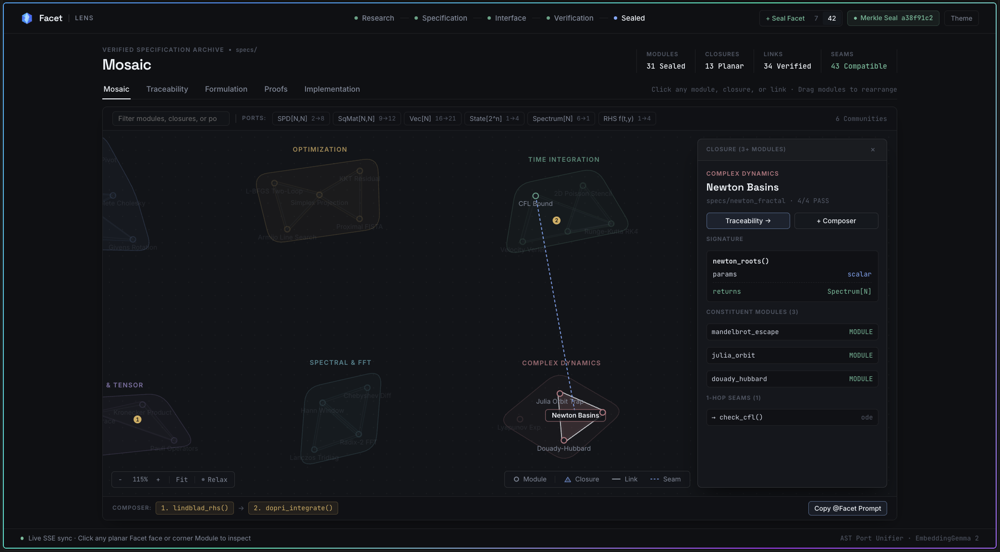

# Facet Roadmap — Mosaic Compositional Workbench

This roadmap specifies the planned evolution of **Facet Lens** (`.github/extensions/facet-lens/`) from single-specification inspection into **Mosaic**: a live, port-grounded specification network browser and compositional workbench for assembling verified `specs/<slug>/` modules into larger frameworks.

---

## Visual & Architectural Design Baseline

The screenshot above illustrates the prospective visual chrome, palette, and interaction layout targeted across `.github/extensions/facet-lens/ui.mjs`, paired with six production mechanisms that keep every graph element grounded in verified contracts and established graph-drawing models:

| Dimension | Design Baseline |
| :--- | :--- |
| **Visual Chrome, Palette & Navigation** | Matte editorial dark/light palette, `facet-prism.svg` topbar mark, masthead title `Mosaic`, concise 5-tab bar (`Mosaic · Traceability · Formulation · Proofs · Implementation`), rounded-corner monotone-chain **community convex hulls** (`cornerR = 22px`, Andrew, 1979), planar `Closure` convex polygon faces (`cornerR = 5px`) with hover/select-only labels, symmetrical HUD + `[ o Module \| ^ Closure  --- Link  ... Seam ]` legend, `< 0.70x` Community Overview zoom, and dismissible Reveal-on-Click Card. |
| **Port Contract Extraction** | **Boundary Port Descriptors + Stage 4 Runtime Witnesses:** Domain-general refinement signatures (`container`, `dtype`, `ndim`, `dim_symbols`, `qualifiers`, `unit`) with unpacked `tuple` output slots `out[k]` authored in Stage 2 `mapping.json` and empirically verified via Stage 4 `pytest` runtime shape/dtype witnesses (Python AST/`assert` fallback for older bundles). |
| **Port Graph & Directionality Cues** | **Port-Polarized Wiring + Ego-Scoped Color & Small Arrowhead:** Directed port-graph / wiring-diagram edges (`from.out[i] -> to.in[j]`; Spivak, 2013; Patterson, Spivak & Vagner, 2021) supporting serial pipes, distinct-port fan-in, and shared-domain operators while rejecting same-port collisions; arrowhead-free at rest, adding a **small inset arrowhead** alongside graded `slate`/`sage` coloring on highlighted 1-hop/2-hop ego seams. |
| **`Closure` vs. `Link` & Convex Polygon Geometry** | **Convex Face Geometry + Non-Member Exclusion Physics:** `3+` upstream constituents = planar `Closure` convex polygon face (`^`, zero artificial center hub nodes); `2` upstreams and `1`-upstream module extensions = verified `Link` (`---`); `Links` count strictly verified pairwise dependencies without fabricating clique edges around a `Closure` perimeter; ForceAtlas2 adds non-member point-in-polygon repulsion (Collins, Penn & Carpendale, 2009) and minimum-altitude triangle regularization. |
| **Multi-Layer Expand / Collapse Hierarchy** | **Compound DAG Cuts (`Convex Face <-> Point Group`):** Any `Closure` face can be collapsed down to a **single point-group node** exposing its sealed outer port signature and expanded back into its constituent polygon face across **arbitrary nesting layers** (Sugiyama & Misue, 1991; Eades & Feng, 1997; Archambault, Munzner & Auber, 2008; Vehlow, Beck & Weiskopf, 2017), letting engineers atomize specifications into independent functions while composing and browsing multi-layer facets as single nodes. |
| **Community Convex Hulls & `Composer` Modes** | **Modularity + 2D MDS Layout & Multi-Mode `Composer`:** Mutual $k$-NN modularity / Leiden partitioning (Newman & Girvan, 2004; Traag, Waltman & van Eck, 2019) over `EmbeddingGemma 2` (`keep_alive: 0`), dynamic 2D classical MDS community centers (Gower, 1966) enclosed by padded monotone-chain convex hulls (suppressed when $N < 4$), majority `domain_category` naming, and explicit `Composer` modes (`EXACT_PORT`, `GUARD_REQUIRED`, `SHARED_DOMAIN_SET`) feeding `@Facet` S1–S4 synthesis via `resolve_mosaic_composer_linked_specs`. |

---

## Milestone 1 — Boundary Port Contracts, Runtime Witnesses & Compound Port-Graph Model

**Goal:** Derive a domain-general, zero-hallucination compatibility and hierarchical composition graph from sealed `specs/<slug>/` packages without brittle prose regexes or hardcoded port names.

### Core Primitives (`Module · Closure · Link · Seam`) & Dual Face / Point-Group Representation
1. **`Module` (`0D` Leaf Vertex `o`):**
   - Represents every standalone atomized specification (`|upstream_modules| == 0`) as well as single-dependency extensions (`|upstream_modules| == 1`, connected to their upstream `Module` by a `Link`).
2. **`Closure` (`2D` Convex Polygon Face `^` $\leftrightarrow$ Collapsed `0D` Point-Group Node, $\ge 3$ upstream constituents):**
   - Represents a verified composite package integrating **three or more** upstream constituents (`len(resolved_constituents) >= 3` verified in `PROVENANCE.json`) within a **compound / hierarchically grouped dependency DAG** (Sugiyama & Misue, 1991; Eades & Feng, 1997; Vehlow, Beck & Weiskopf, 2017).
   - **Expanded state (`Convex Face`):** Rendered directly as the clickable 2D convex hull polygon (Andrew, 1979) spanning its immediate constituent nodes—never inserting a redundant star-hub vertex and never fabricating standalone pairwise `Links` along its polygon boundary unless an independent verified 2-module dependency exists.
   - **Collapsed state (`Point Group`):** Contracts into a single composite node at its centroid exposing only the `Closure`'s own sealed public entrypoint and boundary ports (`in[0..p-1]`, `out[0..q-1]`), matching operadic box encapsulation in hierarchical wiring diagrams (Spivak, 2013).
   - **Recursive multi-layer generalization:** Because a collapsed `Closure` is itself a node with verified boundary ports, it can serve directly as a constituent corner of higher-layer `Closures` (`Layer 0` atomic functions $\leftrightarrow$ `Layer 1` `Closures` $\leftrightarrow$ `Layer 2+` composed frameworks) and be expanded or collapsed layer by layer.
3. **`Link` (`1D` Solid Edge `---`):**
   - Represents an implemented, cryptographically sealed pairwise dependency (`|upstream_modules| == 1` module extension or `|upstream_modules| == 2` verified pairwise bridge, clickable when representing a 2-upstream package).
4. **`Seam` (`1D` Dashed Port Edge `...`):**
   - Represents an **uncomposed**, port-verified compatible directed wire `from_slug.out[i] -> to_slug.in[j]` (or shared-domain operator match) between two visible nodes (`Modules` or collapsed/expanded `Closures`) not yet joined by a verified `Link` or `Closure`.

### Boundary Port Descriptors + Stage 4 Runtime Witnesses
- **Stage 2 Boundary Schema (`mapping_schema.json`):** Extend `public_interface.entrypoints[*]` with optional backward-compatible port descriptors (`container`, `dtype`, `ndim`, `dim_symbols`, `qualifiers`, `unit`) on each input parameter and unpacked return slot (`tuple[T_0, ..., T_{m-1}]` projected into indexed output ports `out[0..m-1]`; Di Cosmo, 1993, 1995; Kennedy, 1994; Guo et al., 2020; Danish, Orchard & Rice, 2024).
- **Stage 4 Empirical Runtime Witness (`pytest_facet_stochastic.py`):** Record observed runtime input/output `(container, dtype, ndim, equal_axes, tuple_arity)` during Stage 4 Cleanroom `pytest` execution into `specs/mosaic_index.json` (falling back to deterministic `ast.parse` over `def` annotations and `precondition_assertions` for pre-existing archives).
- **Refinement Compatibility & Specificity Filtering:**
  - Separate structural base compatibility (`container`, `dtype`, `ndim`, compatible `unit` and `dim_symbols`) from logical refinement qualifiers (`square`, `symmetric`, `positive_definite`, `lower_triangular`, `unit_norm`, `pow2_len`; Rondon, Kawaguchi & Jhala, 2008; Polikarpova, Kuraj & Solar-Lezama, 2016; Mishra & Jagannathan, 2025).
  - Rank ports by inverse-frequency archive specificity $I(p) = -\log_2(\text{freq}(p) / N)$ (Spärck Jones, 1972): high-specificity refined or unit-tagged ports render `Seams` across communities at rest, medium-specificity array ports (`SqMat[N,N]`, `Vec[N]`) scope `Seams` intra-community on ego selection or `Ports:` filtering to avoid $O(N^2)$ cliques, and scalar configuration knobs (`tol: float`, `max_iter: int`) never generate `Seams`.

---

## Milestone 2 — `EmbeddingGemma 2` Modularity Clustering, Community Convex Hulls & `specs/mosaic_index.json`

**Goal:** Partition growing `specs/` archives ($N = 4 \to 200+$) into well-separated semantic communities enclosed by 2D convex hulls without hardcoded names, fixed coordinates, or single-linkage chaining.

- **Post-Archival Vector Indexing (`post_archive_embed.py` & `garden-specs`):**
  - After Stage 5 archival completes (and in `pipeline_guards.py garden-specs`), compute and persist 768D unit embeddings via `embeddinggemma-2:740m-mxfp8` using its symmetrical clustering prompt (`task: clustering | query: <concept_name + pure mathematical formulations>`, Schechter Vera et al., 2025) in `specs/mosaic_index.json`.
  - Pass `"keep_alive": 0` on Stage 5 embedding requests so `embeddinggemma-2` unloads immediately and preserves single-model residency (`OLLAMA_MAX_LOADED_MODELS=1`) for subsequent `@Facet` turns; fall back deterministically to shared LaTeX operator tokens + identifier stems + `domain_category` when Ollama is offline.
- **Modularity / Leiden Partitioning, 2D Classical MDS Centers & Community Convex Hulls:**
  - Partition the mutual $k$-NN cosine similarity graph via modularity / Leiden community detection (Newman & Girvan, 2004; Traag, Waltman & van Eck, 2019 — guaranteeing connected communities without single-linkage chaining at $N \ge 30$, and suppressing community convex hulls cleanly when $N < 4$).
  - Derive community titles deterministically from majority normalized `manifest.json` `domain_category` (or top shared concept bigrams), place community gravity centers `(ax, ay)` via **2D classical MDS** (principal coordinates; Gower, 1966) of inter-community embedding centroids so related domains sit adjacent on the canvas, and enclose each community's active nodes in a padded monotone-chain **2D convex hull** (`cornerR = 22px`, Andrew, 1979).
- **Strict Epistemic Boundary:**
  - `EmbeddingGemma 2` governs **community assignment, ForceAtlas2 spatial gravity basins, and community convex hulls only**; it must never fabricate `Links` or `Seams`.

---

## Milestone 3 — Live 60fps ForceAtlas2 `Mosaic` Browser & Recursive Multi-Layer Expand/Collapse

**Goal:** Upgrade `.github/extensions/facet-lens/{ui.mjs,server.mjs,state.mjs,extension.mjs}` with an interactive, multi-scale network browser replacing the static `Archive` grid.

- **Navigation & Auto-Landing:**
  - Promote **`Mosaic`** (masthead title `Mosaic`) to **Tab 1** (`Mosaic · Traceability · Formulation · Proofs · Implementation`).
  - Auto-focus `Mosaic` when the workspace root is idle with $\ge 1$ sealed package, and auto-focus `Traceability` when an active `S0–S4` run has working root drafts (preserving explicit user tab overrides).
- **Symmetric ForceAtlas2 Engine + Convex Polygon Exclusion & Sliver Regularization:**
  - Zero-dependency vanilla JS ForceAtlas2 solver (Jacomy et al., 2014) using **symmetric undirected forces**: degree-weighted vertex repulsion (`minDist >= 74px`), LinLog `Link`/`Closure` cohesion, MDS community gravity anchors, and swing/traction adaptive speed damping that decays to `0%` CPU once settled.
  - Enforce two $O(|F| \cdot |V_{\text{comm}}|)$ geometric constraints on expanded `Closure` convex hulls: **(a) non-member point-in-polygon repulsion** so unrelated `Modules` never settle inside an expanded `Closure` polygon (preventing false set-enclosure visual membership; Collins, Penn & Carpendale, 2009), and **(b) minimum-altitude triangle struts** so 3-corner `Closures` never degenerate into collinear slivers.
  - Dragging any `Module` or collapsed point-group vertex (`getScreenCTM()` inverse transform) pins its coordinates in `$COPILOT_HOME/extension-data/facet-pipeline-lens/` per workspace until unpinned via `double-click` or `Relax`, while recomputing **Monotone-Chain Community Convex Hulls (`cornerR = 22px`)** and **Expanded `Closure` Convex Hulls (`cornerR = 5px`)** live at `60fps` (Andrew, 1979).
  - Priority bounding-box label culling prevents overlapping text at any density, and zooming below `0.70x` transitions smoothly into **Community Overview** convex hulls (`N modules · M closures`).
- **Recursive Multi-Layer Collapse & Expansion (`Convex Face <-> Single Point Group`):**
  - Combine steerable multi-level hierarchy cuts (Eades & Feng, 1997; Archambault, Munzner & Auber, 2008) with overlapping group-structure semantics when a `Module` participates in multiple `Closures` (Vehlow, Beck & Weiskopf, 2017):
    - **Collapse (`Face -> Point Group`):** Collapsing an expanded `Closure` face contracts its polygon to a single ringed point-group node at the face centroid exposing the `Closure`'s own public boundary ports. Exclusive internal constituents fold into the point group and leave the active ForceAtlas2 vertex set; constituents shared with other still-expanded `Closures` or `Links` remain visible for their sibling faces without severing sibling geometry (Vehlow et al., 2017). External `Links` and `Seams` attach directly to the collapsed node's boundary ports.
    - **Expand (`Point Group -> Face`):** Expanding a point-group node unfolds **one layer down** into its immediate constituent nodes and convex hull face (seeded smoothly around the point group's centroid), keeping any nested sub-`Closures` collapsed as point-group corners until expanded in turn. Persist per-slug expand/collapse cut state alongside pinned coordinates in `$COPILOT_HOME/extension-data/facet-pipeline-lens/`.
- **Port-Polarized 2-Hop Ego Discovery & On-Demand Small Arrowheads:**
  - Keep the resting overview **arrowhead-free** to avoid hub occlusion (Holten & van Wijk, 2009).
  - Selecting an ego (`Module`, `Link`, or collapsed/expanded `Closure`, scoped strictly to that item's own public interface) extends `Seams` **two hops out** over the port-polarized wiring graph—covering **serial pipes** (`ego.out -> m1.in -> m2`), **upstream chains** (`u2 -> u1 -> ego.in`), **through-ego pipes** (`u1.out -> ego -> m1.in`), and **distinct-port fan-in** (`u1.out -> ego.in[p]` + `u2.out -> ego.in[q]` with $p \neq q$; Patterson et al., 2021; Feng et al., 2017) while rejecting same-port collisions—rendered with **graded `slate`/`sage` coloring plus a small, crisp inset arrowhead** on highlighted ego seams.
  - Clicking an item opens a dismissible (`x` or canvas click) **Reveal-on-Click Card** (`Traceability ->`, `Collapse to Node` / `Expand Face`, `+ Composer`, `Signature`, `Upstream Producers -> Ego -> Downstream Consumers`, `Constituent Modules`, and 1-click `Stage` buttons for valid 3-node candidate closures).
- **Symmetrical HUD, Interactive 4-Noun Legend & Incremental SSE Sync:**
  - Bottom-left HUD `[ - 100% + | Fit | * Relax ]` paired with bottom-right Legend `[ o Module | ^ Closure  --- Link  ... Seam ]` (with 1-click `Closure` and `Seam` layer toggles, shifting left when the reveal card opens).
  - Add `/api/snapshot` JSON endpoint in `server.mjs` so SSE `reload` events incrementally merge newly sealed Stage 5 items into the live ForceAtlas2 simulation without resetting camera zoom, hierarchy cut state, or pinned nodes.

---

## Milestone 4 — Closed-Loop Multi-Mode `Composer` & Multi-Layer `mosaic_linked_specs` Seam

**Goal:** Let engineers atomize algorithms into independent verified functions while composing any mix of leaf `Modules` and collapsed higher-order `Closures` into newly verified composite facets across arbitrary layers.

- **Multi-Mode `Composer` Strip (`ui.mjs`):**
  - `Shift+Click` on `Modules`, `Links`, or `Closures`—whether expanded as convex faces or collapsed into single point-group nodes—populates the bottom **`Composer`** workbench, classifying structural relationships without claiming static code synthesis for loop/control-heavy algorithms (Shi, Steinhardt & Liang, 2019):
    - **`EXACT_PORT` (`out[i] -> in[j]`):** Producer output port satisfies all base, dimension/unit, and refinement qualifiers of consumer input port ($Q_{\text{out}} \supseteq Q_{\text{in}}$).
    - **`GUARD_REQUIRED` (`out[i] ->? in[j]`):** Base container, `dtype`, `ndim`, and `unit` match, while unproved target qualifiers ($Q_{\text{in}} \setminus Q_{\text{out}} \neq \emptyset$) are surfaced explicitly for Stage 2/4 verification.
    - **`SHARED_DOMAIN_SET` (`{m_1, m_2, ...}`):** Co-consumed operators sharing a refined domain (e.g., `ichol(A)` + `cg(A, b)` on `SPD[N,N]`) or subroutine helpers staged as a structured module set rather than a forced linear pipe.
  - Copies a ready-to-send `@Facet` composition prompt referencing exact `specs/<slug>` paths and port roles.
- **Uniform Multi-Layer Seam (`resolve_mosaic_composer_linked_specs` & `<upstream_mosaic_ports>`):**
  - Build directly on the existing `resolve_mosaic_composer_linked_specs` seam in [`.github/hooks/scripts/facet_guards/visual_ocr_and_sources.py`](.github/hooks/scripts/facet_guards/visual_ocr_and_sources.py) (`mosaic_linked_specs` in `.pipeline_config.json` / `.pipeline_state.json`). Because leaf `Modules` and multi-layer `Closures` share the identical sealed `specs/<slug>/PROVENANCE.json` contract, staging a collapsed point-group node exposes **only that composite's outer verified interface** to `compute_stage_working_set`, `<workspace_map>`, and `<upstream_mosaic_ports>` hydration—keeping `@Formalist` (Stage 2) and `@Engineer` (Stage 3) context windows bounded at $O(\text{immediate constituents})$ regardless of nesting depth, while keeping unlinked `specs/*` siblings sealed off.
  - Upon Stage 5 archival (following the 500-draw unseeded Cleanroom `pytest` gate and `conftest.py` seal), write `specs/mosaic_index.json` alongside `PROVENANCE.json` and broadcast an SSE update so the newly verified `Link` ($2$ constituents) or expandable/collapsible `Closure` ($\ge 3$ constituents) appears live in `Mosaic`.

---

## Supporting Academic & arXiv References

- **Hierarchical Wiring Diagrams & Multi-Argument Component Synthesis:**
  - Spivak, D. I. (2013). *The operad of wiring diagrams: formalizing a graphical language for databases, recursion, and plug-and-play circuits* (`arXiv:1305.0297`).
  - Patterson, E., Spivak, D. I., & Vagner, D. (2021). *Wiring diagrams as normal forms for computing in symmetric monoidal categories*. EPTCS 333, 49–64 (`arXiv:2101.12046`, DOI: `10.4204/EPTCS.333.4`).
  - Feng, Y., Martins, R., Wang, Y., Dillig, I., & Reps, T. (2017). *Component-based synthesis for complex APIs (SyPet)*. POPL '17, 599–612 (DOI: `10.1145/3009837.3009851`).
  - Guo, Z., James, M., Justo, D., Zhou, J., Wang, Z., Jhala, R., & Polikarpova, N. (2020). *Program synthesis by type-guided abstraction refinement*. PACMPL 4(POPL), Article 12, 1–28 (`arXiv:1911.04091`, DOI: `10.1145/3371080`).
  - Shi, K., Steinhardt, J., & Liang, P. (2019). *FrAngel: component-based synthesis with control structures*. PACMPL 3(POPL), Article 73, 1–29 (`arXiv:1811.05175`, DOI: `10.1145/3290386`).
- **Logical Refinement Qualifiers, Units of Measure, Type Isomorphisms & Specificity:**
  - Rondon, P. M., Kawaguchi, M., & Jhala, R. (2008). *Liquid types*. PLDI '08, 159–169 (DOI: `10.1145/1375581.1375602`).
  - Polikarpova, N., Kuraj, I., & Solar-Lezama, A. (2016). *Program synthesis from polymorphic refinement types (Synquid)*. PLDI '16, 522–538 (`arXiv:1510.08419`, DOI: `10.1145/2908080.2908093`).
  - Mishra, A., & Jagannathan, S. (2025). *Close is Good Enough: Component-Based Synthesis Modulo Logical Similarity* (`arXiv:2508.14614`).
  - Di Cosmo, R. (1993). *Deciding type isomorphisms in a type-assignment framework*. Journal of Functional Programming, 3(4), 485–525 (DOI: `10.1017/S0956796800000861`); Di Cosmo, R. (1995). *Isomorphisms of Types: From $\lambda$-Calculus to Information Retrieval and Language Design*. Birkhäuser.
  - Kennedy, A. J. (1994). *Dimension types*. Programming Languages and Systems — ESOP '94, LNCS 788, 348–362 (DOI: `10.1007/3-540-57880-3_23`); Danish, M., Orchard, D., & Rice, A. (2024). *Incremental units-of-measure verification* (`arXiv:2406.02174`).
  - Spärck Jones, K. (1972). *A statistical interpretation of term specificity and its application in retrieval*. Journal of Documentation, 28(1), 11–21 (DOI: `10.1108/eb026526`).
- **Compound & Overlapping Group Graphs, Convex Hulls, Modularity, MDS & Directed Edges:**
  - Sugiyama, K., & Misue, K. (1991). *Visualization of structural information: automatic drawing of compound digraphs*. IEEE Transactions on Systems, Man, and Cybernetics, 21(4), 876–892 (DOI: `10.1109/21.108304`).
  - Eades, P., & Feng, Q.-W. (1997). *Multilevel visualization of clustered graphs*. Graph Drawing (GD '96), LNCS 1190, 101–112 (DOI: `10.1007/3-540-62495-3_41`).
  - Archambault, D., Munzner, T., & Auber, D. (2008). *GrouseFlocks: Steerable Exploration of Graph Hierarchy Space*. IEEE Transactions on Visualization and Computer Graphics, 14(4), 900–913 (DOI: `10.1109/TVCG.2008.34`).
  - Collins, C., Penn, G., & Carpendale, S. (2009). *Bubble Sets: Revealing Set Relations with Isocontours over Existing Visualizations*. IEEE Transactions on Visualization and Computer Graphics, 15(6), 1009–1016 (DOI: `10.1109/TVCG.2009.122`).
  - Vehlow, C., Beck, F., & Weiskopf, D. (2017). *Visualizing Group Structures in Graphs: A Survey*. Computer Graphics Forum, 36(6), 201–225 (DOI: `10.1111/cgf.12872`).
  - Andrew, A. M. (1979). *Another efficient algorithm for convex hulls in two dimensions*. Information Processing Letters, 9(5), 216–219 (DOI: `10.1016/0020-0190(79)90072-3`).
  - Jacomy, M., Venturini, T., Heymann, S., & Bastian, M. (2014). *ForceAtlas2, a Continuous Graph Layout Algorithm for Handy Network Visualization Designed for the Gephi Software*. PLOS ONE, 9(6), e98679 (DOI: `10.1371/journal.pone.0098679`).
  - Holten, D., & van Wijk, J. J. (2009). *A user study on visualizing directed edges in graphs*. Proceedings of the SIGCHI Conference on Human Factors in Computing Systems (CHI '09), 2299–2308 (DOI: `10.1145/1518701.1519054`).
  - Newman, M. E. J., & Girvan, M. (2004). *Finding and evaluating community structure in networks*. Physical Review E, 69(2), 026113 (DOI: `10.1103/PhysRevE.69.026113`); Traag, V. A., Waltman, L., & van Eck, N. J. (2019). *From Louvain to Leiden: guaranteeing well-connected communities*. Scientific Reports, 9, 5233 (DOI: `10.1038/s41598-019-41695-z`).
  - Gower, J. C. (1966). *Some distance properties of latent root and vector methods used in multivariate analysis*. Biometrika, 53(3–4), 325–338 (DOI: `10.1093/biomet/53.3-4.325`).
  - Schechter Vera, H., et al. (2025). *EmbeddingGemma: Powerful and Lightweight Text Representations* (`arXiv:2509.20354`).
