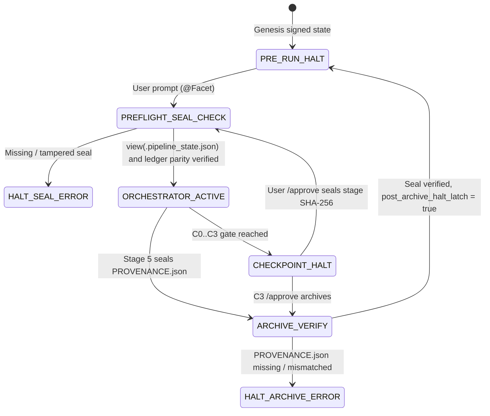

# Facet System Architecture and Theoretical Foundations

Facet is a specification-driven engineering and cleanroom verification harness built inside Visual Studio Code using native GitHub Copilot customizations and local Google DeepMind Gemma 4 models.

---

## 1. Theoretical Foundations

Rather than relying on unconstrained LLM text generation, Facet grounds code generation in four formal principles from software engineering and programming language theory:

### A. Stepwise Specification Refinement ([Wirth, 1971](https://doi.org/10.1145/362575.362577); Morgan, 1994)
High-level scientific and technical specifications cannot be translated directly into executable code in a single leap without compounding hallucinations. Facet structures translation into progressive, typed intermediate representations:

$$
\text{PDF / Figures} \xrightarrow{\text{S0V}} \text{SOURCE\_TEXT.md + SOURCE\_OCR.md} \xrightarrow{\text{S0}} \text{RESEARCH.md} \xrightarrow{\text{S1}} \text{manifest.json (SPEC-}k\text{)} \xrightarrow{\text{S2}} \text{mapping.json (OBL-}j\text{)} \xrightarrow{\text{S3}} \text{Source Code} \xrightarrow{\text{S4}} \text{VERIFICATION.md}
$$

Every stage refines and formalizes the contracts of the preceding stage.

### B. Two-Phase Cleanroom Isolation & Information Confinement ([Mills, Dyer, & Linger, 1987](https://doi.org/10.1109/MS.1987.231413); [Lampson, 1973](https://doi.org/10.1145/362375.362389))
Classical Cleanroom software engineering separates code construction from certification and withholds developer program execution prior to independent statistical testing ([Mills, Dyer, & Linger, 1987](https://doi.org/10.1109/MS.1987.231413)), while Lampson's confinement model restricts unauthorized information channels between executing components ([Lampson, 1973](https://doi.org/10.1145/362375.362389)). Facet preserves that boundary between implementation and certification through a finite-state reference monitor ([Schneider, 2000](https://doi.org/10.1145/353323.353382)) while tailoring runtime checks to local open-weight models:
- The software builder (`@Engineer`) receives a unified Cleanroom Engineering Build Sheet (`engineer_hydration_mode = "unified_build_sheet"`, joining `manifest.json` equations/domains with `mapping.json` interfaces/preconditions while redacting `anchor_test_cases` and `expected` values under `s2_s3_selective_hydration`), operates under a bounded `3/3` inline `python -c` smoke-probe budget on its own module, and is barred by `preToolUse` hooks from reading or executing test oracle scripts (`verify_*.py`) or mutating sealed upstream specifications.
- The verification auditor (`@Auditor`) receives AST public signature/docstring stubs (`<hydrated_public_surface>`) and is path-confined to `verify_*.py`, `test_*.py`, `VERIFICATION.md`, and `AUDIT_FEEDBACK.json`. Under default `two_phase_post_pytest` read gating, `@Auditor` authors `verify_*.py` blind to `<target_module>.py` and unlocks read-only source inspection only after a failing `pytest` run so minimal counterexamples can be isolated accurately.
This prevents self-fulfilling test suites where a model weakens assertions to match flawed code while retaining post-failure diagnostic precision.

### C. Four-Predicate Verification Taxonomy ([Claessen & Hughes, 2000](https://doi.org/10.1145/351240.351266); [Hughes, 2020](https://doi.org/10.1007/978-3-030-47147-7_4); [Weyuker, 1982](https://doi.org/10.1093/comjnl/25.4.465); [Chen et al., 1998](https://arxiv.org/abs/2002.12543))
Instead of coupling verification to a single symbolic algebra library, Facet lowers formal specifications into four complementary verification predicate families:
1. **`anchor` (Pinned Vectors):** Literature-derived boundary cases, physical constants, and closed-form reference points ($f(x_0) \approx y_0$).
2. **`reference_model` (Pseudo-Oracle Differential Testing):** Observational equivalence against a direct, transparent reference implementation on small or discrete domains ([Weyuker, 1982](https://doi.org/10.1093/comjnl/25.4.465); McKeeman, 1998; [Zhang et al., 2023](https://arxiv.org/abs/2305.14591)).
3. **`relational_law` (Metamorphic & Algebraic Invariants):** Multi-call identities ($f(T(x)) \sim g(f(x))$, round-trip `decode(encode(m)) == m`, equivariance, conservation) where no single-call closed-form oracle exists ([Chen et al., 1998](https://arxiv.org/abs/2002.12543); [Hughes, 2020](https://doi.org/10.1007/978-3-030-47147-7_4)).
4. **`postcondition` (Property-Based Contracts):** Universal invariant checks, output shape/domain bounds, and randomized counterexample shrinking via Hypothesis ([MacIver et al., 2019](https://doi.org/10.21105/joss.01891); [Claessen & Hughes, 2000](https://doi.org/10.1145/351240.351266)).

### D. Two-Tier Hybrid Validation, Execution-Guided Self-Repair & Bidirectional Rewinds ([Shinn et al., 2023](https://arxiv.org/abs/2303.11366); [Chen et al., 2024](https://arxiv.org/abs/2304.05128))
Facet pairs looped **local stage validation** (`S0V`–`S3` deterministic AST/schema/foreign-key/stub-`mypy`/anti-leakage gates plus a single-pass `STAGE_1_CRITIC` executable toy-vector sanity audit on source-backed multi-specification manifests via `enable_local_spec_critic = "s1_only"`) with **global Stage 4 cleanroom verification** (`VERIFICATION.md` deterministically requires `pytest` execution proof and rejects `CONDITIONAL_PASS` or any `OBL-j: FAILED` verdict):
- Drawing on verbal reinforcement learning ([Shinn et al., 2023](https://arxiv.org/abs/2303.11366)) and unit-test-driven self-debugging ([Chen et al., 2024](https://arxiv.org/abs/2304.05128)) while replacing unconstrained reflection prose with schema-validated diagnostics, `@Auditor` writes failure records to `AUDIT_FEEDBACK.json` documenting the failed obligation, minimal counterexample, expected oracle, and normalized `failure_classification` (`AUDIT_FEEDBACK.json` and `repair_history` are preserved across repairs and archived as `AUDIT_HISTORY.json` at Stage 5).
- **Artifact-Preserving Scoped Patching & Stage 3 Solvability Escalation:** All workspace artifacts remain on disk across failed local/global validations—new deliverables are authored once via `create`, and subsequent fixes apply minimal scoped replacements via `edit` or `code_patch.py`. Both Stage 4 (`@Auditor`) and Stage 3 (`@Engineer`) route `IMPLEMENTATION_DEFECT` to `@Engineer` (`Stage 3`), rewind `MAPPING_DEFECT` to `@Formalist` (`Stage 2`, unsealing C2 while preserving all files on disk), and rewind `MANIFEST_DEFECT` to `@Researcher` (`Stage 1`, unsealing C1 & C2 while preserving all files on disk; pausing at the re-opened Checkpoint 1 card in `strict-4-gate`).
- A deterministic circuit breaker ($K_{\max}=3$) halts execution and escalates to human review (`CHECKPOINT_REPAIR_ESCALATION`) if automated repair does not converge within three attempts.

### E. Vision/PDF Modality Firewall, Transcriptional Uncertainty Markup ([TEI P5 Ch. 12](https://tei-c.org/release/doc/tei-p5-doc/en/html/PH.html#PHDA)) & Scoped-Edit Sandboxes
- **Modality Firewall, Lossless PNG Plates & Vector-Glyph Anchors:** Gemma 4 E4B (`@Scribe`) incorporates a dedicated `~150M` Vision Encoder at deterministic `T=0.1`, whereas reasoning specialists (`@Researcher`, `@Formalist`, `@Engineer`, `@Auditor`) run at `T=1.0`. `preToolUse` deterministically isolates all `.pdf`, `.png`, `.jpg`, and `research/` visual perception inside `@Scribe` (`Stage 0V` -> `SOURCE_OCR.md`), staging lossless `200 DPI` PNG page plates alongside per-plate `CGPDFScanner` math-token `<vector_glyph_anchor>` hints while keeping `SOURCE_TEXT.md` prose separate.
- **Transcriptional Uncertainty Markup ([TEI P5 §3.5.3 & Ch. 12](https://tei-c.org/release/doc/tei-p5-doc/en/html/PH.html#PHDA)):** Adapting the `<unclear>` and `<gap>` editorial markup conventions of the Text Encoding Initiative, degraded or occluded glyphs are recorded in `SOURCE_OCR.md` with a compact two-element XML vocabulary—`<uncertain raw="..." guess="..." reason="..." confidence="...">` and `<illegible context="..." reason="occluded"/>`—which `postToolUse` propagates into `manifest.json` `ambiguities` and `"epistemic_status": "assumption"`.
- **Create-Once, Scoped-Edit Sandboxes, Raw `r"""` Docstrings & Stage 5 Pruning:** Deliverables are created once via `create` and revised via scoped `edit` (backed by 4-stage `resolve_edit_pair()` auto-snap across JSON, Markdown, and Python) or `code_patch.py` (`replace-symbol`, `replace-lines`, `replace-json`), with line-numbered remediation hints, raw `r"""` LaTeX docstring promotion, anchor-scoped anti-leakage AST checks, and Stage 5 dead-helper / unused-import / unused-dependency pruning prior to `PROVENANCE.json` sealing.

---

## 2. The 6-Layer Synergy Architecture

```mermaid
flowchart TD
    subgraph L1["Layer 1: Ambient Instructions"]
        I1["copilot-instructions.md<br/>(Path-First Calls, Create-Once/Scoped-Edit, Strict Typing, Preconditions, Tolerances)"]
    end
    subgraph L2["Layer 2: Custom Agent Personas"]
        A0["Facet (E4B, visible read-only hypervisor)"]
        A1["Orchestrator (E4B Routing, hidden)"]
        A6["Scribe (E4B Vision OCR -> SOURCE_OCR.md)"]
        A2["Researcher (26B-A4B -> RESEARCH.md, manifest.json)"]
        A3["Formalist (26B-A4B -> mapping.json)"]
        A4["Engineer (26B-A4B -> requirements.txt, .venv, *.py)"]
        A5["Auditor (26B-A4B -> verify_*.py, VERIFICATION.md)"]
    end
    subgraph L3["Layer 3: Agent Skills (agentskills.io)"]
        S1["spec-pipeline (/spec-pipeline)"]
        S2["technical-perception (schema.json + prepare_visual_sources.py)"]
        S3["formal-mapping (mapping_schema.json)"]
        S4["implementation-engineering (lint_rules.json + code_patch.py)"]
        S5["verification-auditing (/verification-auditing)"]
    end
    subgraph L4["Layer 4: Toolchain Adapter"]
        T1["Isolated Virtual Environment (./.venv/bin/python + ruff format)<br/>+ .pipeline_config.json verification_globs / py_compile"]
    end
    subgraph L5["Layer 5: Deterministic Hook Control Plane"]
        H1["pipeline_guards.py Facade + 9-Layer facet_guards/ Package<br/>(Modality Firewall, Selective Hydration, Two-Phase Cleanroom, AST-1..6 Gates, Format-Symmetric Edit Snap, Method L3 Scope, FSM & Write-Locks)"]
    end
    subgraph L6["Layer 6: Ollama Compute Plane (Apple Silicon M5 Pro 64GB)"]
        M1["OLLAMA_MAX_LOADED_MODELS=1 | KV_CACHE_TYPE=q8_0 (GGUF)<br/>Clean-Stop PARSER gemma4 | 128K num_ctx | T=0.1 E4B / T=1.0 26B-A4B | AST-Risk-Gated pplx-decider-flash (keep_alive=0)"]
    end

    L1 --> L2
    L2 --> L3
    L3 --> L4
    L4 --> L5
    L5 --> L6
```



### Layer 1: Ambient Instructions (`copilot-instructions.md`) & `subagentStart` Injection
Active on the root session agent in VS Code and across standalone Copilot CLI subagents (when `include-custom-instructions: true` is set). Because VS Code's custom-agent converter does not forward `include-custom-instructions` or `strict-tools-list` to spawned subagents, `pipeline_guards.py` deterministically injects role-tailored invariants via `subagentStart` (`<subagent_context>`) and enforces tool boundaries via `preToolUse`. Kept under 35 lines (~350 tokens) to minimize baseline token overhead.

### Layer 2: Custom Agent Personas (`.agent.md`)
Follows the official Coordinator-Worker pattern, declaring VS Code's 6 core frontmatter tool categories (`read`, `edit`, `execute`, `search`, `agent`, `web`—deliberately omitting `todo` schema bloat in favor of zero-tool-call deterministic `<stage_checklist>` injection via `subagentStart`) while binding prompt instructions to the exact runtime wire schemas (`view`, `create`, `edit`, `grep`, `glob`, `web_fetch`, `bash`, `task`):
- **`@Facet`:** The sole user-visible agent (`user-invocable: true`, `disable-model-invocation: true`, `tools: ['read', 'edit', 'execute', 'search', 'agent', 'web']`, `gemma4:e4b`). Like `@Orchestrator`, `@Facet` declares the 6-category ceiling so grandchild specialists (`@Scribe`, `@Researcher`, `@Formalist`, `@Engineer`, `@Auditor`) inherit `bash`, `create`, `edit`, `grep`, `glob`, and `web_fetch` under Copilot SDK `1.0.108+` transitive tool intersection, while `hypervisor-guard` (`preToolUse`) confines `@Facet` strictly to text/JSON `view` seal reads and `task(agent_type="Orchestrator", mode="sync")`. See [Section 5](#5-the-facet-hypervisor-split-plane-architecture).
- **`@Orchestrator`:** Hidden internal coordinator (`user-invocable: false`, `disable-model-invocation: false`, `tools: ['read', 'edit', 'execute', 'search', 'agent', 'web']`). Declares the full 6-category ceiling so child subagents inherit `create`, `edit`, `bash`, and `web_fetch` in Copilot SDK `1.0.108+`, while agent-scoped inline hooks (`coordinator-guard`, `orchestrator-prompt`, `orchestrator-stop`) deterministically deny direct file edits, shell commands, URL fetches, `skill`, or `rename_chat` calls on `@Orchestrator`, strip unreachable auto-title `<system_reminder>` blocks, reconcile mid-turn steered `/approve` messages, and enforce Checkpoint Gate sign-off fidelity. Follows the deterministic `<stage_checklist>` injected at `subagentStart` and delegates exclusively via `task`.
- **`@Scribe`:** Upstream Stage 0V Vision/PDF OCR specialist (`tools: ['read', 'edit', 'execute', 'search']` -> confined strictly to running `prepare_visual_sources.py`, inspecting staged plates 1 at a time, and writing isolated `ocr_staging/plates/<stem>.md` transcripts assembled deterministically into `SOURCE_OCR.md`).
- **`@Researcher`:** Literature grounding and specification specialist (`tools: ['read', 'edit', 'search', 'web']` -> wire tools `view`, `create`, `edit`, `grep`, `glob`, `web_fetch`). Synthesizes `SOURCE_TEXT.md`, `SOURCE_OCR.md`, and approved research domains from [approved_sources.json](../.github/hooks/approved_sources.json) into `RESEARCH.md` (Stage 0) and compiles `manifest.json` (Stage 1, under Markovian `RESEARCH.md`-only isolation when `RESEARCH.md` exists).
- **`@Formalist`:** Discrete computational architect (`tools: ['read', 'edit', 'search']` -> writes `mapping.json` directly via `create` in Stage 2).
- **`@Engineer`:** Production software and environment builder (`tools: ['read', 'edit', 'execute', 'search']` -> authors/updates `requirements.txt`, provisions `./.venv`, and writes `*.py` production modules in Stage 3 guided by AST-grounded `<stage_checklist>` entrypoint checklists).
- **`@Auditor`:** Cleanroom verification auditor (`tools: ['read', 'edit', 'execute', 'search']` -> path-confined to `verify_*.py`, `test_*.py`, `VERIFICATION.md`, and `AUDIT_FEEDBACK.json` in Stage 4 guided by obligation-grounded `<stage_checklist>` verification checklists).

### Layer 3: Agent Skills Open Standard (`agentskills.io`)
Portable directories containing declarative JSON schemas, visual extraction helpers, structural code patchers, reference templates, and linting rules:
- `spec-pipeline`: `S0V + S0->S5` lifecycle state machine and slash commands (`/spec-pipeline`).
- `technical-perception`: [prepare_visual_sources.py](../.github/skills/technical-perception/scripts/prepare_visual_sources.py) (`200 DPI` PDF/web-figure staging + deterministic `SOURCE_TEXT.md` extraction), research brief templates, and `schema.json`.
- `formal-mapping`: Discrete type mappings, public interfaces, and `mapping_schema.json`.
- `implementation-engineering`: Strict typing standards, `lint_rules.json`, and [code_patch.py](../.github/skills/implementation-engineering/scripts/code_patch.py) (`inspect`, `replace-symbol`, `replace-lines`, `replace-json`).
- `verification-auditing`: 4-predicate verification templates, `audit_feedback_schema.json`, and slash commands (`/verification-auditing`).

### Layer 4: Python Execution Toolchain
Defaults to an isolated virtual environment (`./.venv/bin/python`) with standard library AST checkers, `ruff format`, and native OS `PDFKit`/`pdftoppm` visual extraction. Declarative configuration in `.pipeline_config.json` allows customizing `verification_globs`, `enable_local_spec_critic`, and `static_validator` (`py_compile` or `none`).

### Layer 5: Deterministic Hook Control Plane (`pipeline_guards.py` & `facet_guards/`)
A zero-VRAM stdlib Python reference monitor structured as a 9-layer acyclic package ([facet_guards/](../.github/hooks/scripts/facet_guards/)) behind the backward-compatible [pipeline_guards.py](../.github/hooks/scripts/pipeline_guards.py) CLI facade, implementing 13 lifecycle hook events and 20 CLI actions (including `garden-specs` and `reset`):
- **Scope-Aware Hook Precedence:** Resolves `--scope workspace` vs. `--scope user`, eliminating double execution.
- **Stateless Subagent Identification & Role-Scoped `<workspace_map>`:** Extracts `agentType` / `agentId` directly from official Copilot hook inputs and injects compact modality, specification, `.venv`, and AST line-span maps per non-hypervisor role.
- **Modality Firewall, Stage Routing & Scoped-Edit Confinement:** Blocks raw visual/PDF reads on text-confined models, enforces 1-to-1 `STAGE_SPECIALIST_ALLOWLIST` `task` routing, confines `@Scribe` strictly to `prepare_visual_sources.py` + plate-inspected `SOURCE_OCR.md`, and enforces Create-Once / Scoped-Edit persistence (`edit` / `code_patch.py` on existing files).
- **Two-Tier Post-Tool Validation & Execution Proof:** Normalizes Gemma `<|"|>` JSON escapes to strict RFC 8259 JSON, promotes backslashed Python docstrings to raw `r"""`, enforces `<uncertain>`/`<illegible/>` -> `ambiguities`/`assumption` provenance, verifies target-module AST entrypoints and anchor-scoped anti-leakage rules, enforces `pytest` proof-of-execution before `VERIFICATION.md` sign-off, and keeps drafts on disk with line-numbered remediation hints for in-place repair.
- **User Prompt Handling:** Manages contractual `/approve`, `/status`, `/reset`, and `/add-source` transitions while injecting `<checkpoint_gate>`, `<status_pulse>`, and Cycle-2 `specs/<slug>/` context via `userPromptTransformed`. Workspace visual inspection is served out-of-band at zero LLM token cost by the [`Facet Lens`](../.github/extensions/facet-lens/extension.mjs) Copilot Canvas extension (`127.0.0.1` loopback HTTP + SSE).

### Layer 6: Ollama Modelfiles & Compute Plane
Configures inference parameters compiled via Ollama `/api/create` with `"stop": []` (so zero custom `PARAMETER stop` strings intercept native `PARSER gemma4` thinking or tool-call delimiters):
- 128K context windows (`num_ctx 131072`) to accommodate complex specifications.
- Empirically verified sampling (`T=0.1, top_p=0.95, top_k=64` on `E4B`; `T=1.0, top_p=0.95, top_k=64` on `26B-A4B`).
- Strict single-model residency and 8-bit KV cache (`OLLAMA_MAX_LOADED_MODELS=1`, `OLLAMA_FLASH_ATTENTION=1`, `OLLAMA_KV_CACHE_TYPE=q8_0`, configured via `launchctl setenv` on macOS): keeps `loaded runners count=1` so inactive models do not hold wired Metal memory or evict the macOS unified page cache (`~1.6 s` `E4B`, `~4.1–5.0 s` `26B-A4B`, `~0.9 s` boundary `pplx-decider-flash` with `"keep_alive": 0`; `0.0 s` swap across `S1 -> S2 -> S3 -> S4` via unified `26B-A4B` and `0.0 s` swap on `@Facet <-> @Orchestrator` via shared `gemma4:e4b`), and cuts the GGUF `26B-A4B` 128K KV buffer by 45% (`2860.00 MiB -> 1572.50 MiB` via `llama-server`) while Safetensors `mlx` models (`E4B`, `EmbeddingGemma 2`) retain native Metal KV caches; see `modelfiles/README.md`.

---

## 3. Asymmetric Cognitive Allocation

Facet matches modality and cognitive load to each local model's native architecture:

| Role | Model Architecture | Parameters & Encoder | Mode & Sampling | Cognitive Focus |
| :--- | :--- | :--- | :--- | :--- |
| **`@Researcher`**, **`@Formalist`**, **`@Engineer`** & **`@Auditor`** | Gemma 4 26B-A4B MoE | 25.2B total / 3.8B active | System-2 (`T=1.0, p=0.95, k=64`) | Unified ~52–55 tok/s literature grounding (`RESEARCH.md`, `manifest.json`), discrete formalization (`mapping.json`), coding, Hypothesis fuzzing, and `VERIFICATION.md` with zero `S1..S4` swap. |
| **`@Scribe`** | Gemma 4 E4B Vision | 4.5B PLE + `~150M` Vision Encoder | Direct Vision (`T=0.1, p=0.95, k=64`) | Upstream Stage 0V PDF/diagram/web-figure OCR (`SOURCE_OCR.md`) with TEI P5 provenance. |
| **`@Orchestrator`** *(hidden)* | Gemma 4 E4B | 4.5B effective PLE | Direct Routing (`T=0.1, p=0.95, k=64`) | Sub-second `S0V + S0->S5` routing and checkpoint briefs (`0.0s` swap with `@Facet` and `@Scribe`). |
| **`@Facet`** *(visible)* | Gemma 4 E4B | 4.5B effective PLE | Direct Gating (`T=0.1, p=0.95, k=64`) | Transient read-only hypervisor: seal validation, internal `@Orchestrator` invocation, archive verification (`0.0s` swap, shared E4B runner). |
| **System-1 Boundary Decider** *(hook-invoked)* | `pplx-decider-flash` | 4B Vision+Text (`keep_alive=0`, `ast_risk_gated`) | Calibrated `choice`/`noul` (`0` output tok) | AST-risk-gated `<1 s` semantic spec screening (`tau=0.85`, `0` loads on clean specs), Stage-4 diagnosis-vs-label override, and `Method L3` AST/JSON hunk edit-scope localization (`0 B` persistent VRAM). |

---

## 4. RFC 6962 Binary Merkle Provenance, Merkle DAG Chaining & Composite Sealing

Upon Stage 5 completion, `pipeline_guards.py` archives all deliverables into `specs/<concept_slug>/` and compiles `PROVENANCE.json`:

```json
{
  "concept_slug": "mandelbrot_iteration",
  "status": "VERIFIED_COMPLETE",
  "archived_at": "2026-11-14T20:00:00.000Z",
  "artifact_hashes": {
    "SOURCE_TEXT.md": "19f7a8b0c2d4e6f8091a2b3c4d5e6f70...",
    "SOURCE_OCR.md": "3b19c4d8e2f0a1b2c3d4e5f60718293a...",
    "RESEARCH.md": "d28bd7a3acb7e47ec492dfbf21894aed...",
    "manifest.json": "8751d154ca8d56e2177c5e2191851ccf...",
    "mapping.json": "7c7d2b53f1530bdbc5b621dee88dabd5...",
    "VERIFICATION.md": "e9f0a1b2c3d4...",
    "README.md": "a402c91e7b8d...",
    "verify_mandelbrot_iteration.py": "4a18c9d0e1f2...",
    "hook_state_snapshot.json": "6d02f8a1c3e9...",
    "mandelbrot.py": "b2e6d849104a...",
    "requirements.txt": "91bc04e7a8d3..."
  },
  "merkle_root_sha256": "a2005ca2c8de0c34bf5b8161b8f6d3b3...",
  "repair_attempts": 0,
  "handshakes": [
    {
      "agent": "Researcher",
      "stage": "STAGE_1_SPECIFICATION",
      "artifact": "manifest.json",
      "sha256": "8751d154ca8d56e2177c5e2191851ccf...",
      "status": "SUCCESS"
    }
  ],
  "seal_sha256": "5e1a0c9b7d42f3a8..."
}
```

`merkle_root_sha256` is a domain-separated binary Merkle tree root ([Merkle, 1987](https://doi.org/10.1007/3-540-48184-2_32); [RFC 6962 §2.1](https://www.rfc-editor.org/rfc/rfc6962#section-2.1), `0x00` leaf prefix, `0x01` interior node prefix, power-of-two split without odd-leaf duplication) over sorted `artifact:<path>` digests plus any `upstream:<slug>` roots (`upstream_merkle_roots`), enabling both logarithmic single-file inclusion proofs (`build_merkle_audit_path` / `verify_merkle_audit_path`) and multi-layer compositional Merkle DAG verification. `seal_sha256` then signs the canonical (sorted-key, compact) JSON of the complete provenance record (covering `merkle_root_sha256`, `handshakes`, `status`, and metadata). This provides tamper-evident end-to-end auditability and provenance from literature citation to verified module. The seal is mirrored out of the workspace (Section 5) and re-verified by `@Facet` after archival.

---

## 5. The `@Facet` Hypervisor: Split-Plane Architecture

Small local models loop, mis-serialize tool calls, and drift when one long session carries the whole workflow. Facet therefore keeps governance out of the model: a transient LLM control plane (`@Facet`) wraps the pipeline, and an always-on deterministic reference monitor (`pipeline_guards.py`) enforces every rule while the LLM is away.



### Control Plane vs. Enforcement Plane

| Plane | Component | Residency | Responsibility |
| :--- | :--- | :--- | :--- |
| **Control (transient)** | `@Facet` on shared `gemma4:e4b` | Active only at ingress, checkpoint transitions, and post-archive verification | Reads seals via `view`, invokes `@Orchestrator`, reports `HALT_*` errors, emits the Execution Summary and Next-Cycle Prompt. |
| **Enforcement (always-on)** | `pipeline_guards.py` | No VRAM, CPU only | Write-locks, FSM sequence gates, Cleanroom confinement, atomic state writes, Shadow Seal Ledger, and the `hypervisor-guard` that denies any non-`view`, non-`task` call from `@Facet`. |

### Persistent vs. Transient Hypervisor (64GB Apple Silicon, `num_ctx 131072`)

| Dimension | Persistent co-resident hypervisor (`MAX_LOADED_MODELS` unset / `2`) | Transient hypervisor (shared `gemma4:e4b`, prescribed `OLLAMA_MAX_LOADED_MODELS=1`) |
| :--- | :--- | :--- |
| Peak wired Metal memory | `37.0 GB` (`26b-a4b` `27.59 GB` + `e4b` `9.42 GB` co-resident), unnecessarily pinning idle VRAM | `~27.6 GB` (`26b-a4b` with `q8_0` KV across all four text specialists; `9.42 GB` `e4b`; `5.63 GB` transient `pplx-decider-flash` with `keep_alive=0`) |
| `@Facet <-> @Orchestrator` model change | None (same tag) | `0.0 s` (same `gemma4:e4b` tag; a separate `e2b` tag would force a `7.5 <-> 9.4 GB` swap) |
| `@Facet` return after a worker ran | `~0.06 s` across 8 stage transitions while `ast_risk_gated` keeps the active set to 2 models (`e4b` + `26b-a4b`); `~3.7 s` if a 3rd model loads | `~1.6 s` reload from warm macOS page cache |
| Throughput benefit while workers run | None: `@Facet` is suspended awaiting `task` (`0 tok/s`) | None lost |
| Mid-run interception | None: the parent LLM is suspended awaiting `task` | Handled synchronously on CPU by `pipeline_guards.py` |
| Unified-memory page-cache pressure | Holds `~9.4 GB` wired (`37.0 GB` total with `26b-a4b`, leaving `~27 GB` headroom on 64GB systems so long as `pplx-decider-flash` uses `keep_alive=0`) | Unloads inactive models immediately on transition, keeping OS page cache warm |

`gemma4:e2b` stores 5.20B parameters (7.5 GB) because of Per-Layer Embeddings, only ~2.0 GB less than `gemma4:e4b` (9.5 GB), so it does not justify a separate tag on this hardware.

### Blind Spots While `@Facet` Is Away, and Their Mitigations

| # | Blind spot | Mitigation (runs on every worker call) |
| :--- | :--- | :--- |
| 1 | TOCTOU tampering with an approved `manifest.json` / `mapping.json` | SHA-256 write-locks against `approved_sha256` in `preToolUse` / `postToolUse` |
| 2 | Stage skipping by `@Orchestrator` | FSM sequence gates on every `task` call |
| 3 | `@Engineer` / `@Auditor` cross-contamination during test authoring or repair loops | Cleanroom-redacted S3 `mapping.json` hydration + Two-Phase `@Auditor` `<target_module>.py` read/shell lock (`two_phase_post_pytest`) + symmetrical write confinement |
| 4 | Torn reads or lost updates of `hooks_state.json` / `.pipeline_state.json` / `PROVENANCE.json` | Two-layer `fcntl.flock` serialization (`64` session/workspace stripes + `hooks_state_global.flock` merge-write) and unique `<pid>.<time_ns>.tmp` -> `os.replace()` atomic writes |
| 5 | Worker code rewriting both an artifact and its recorded in-workspace hash | Tamper-evident out-of-workspace Shadow Seal Ledger: `$COPILOT_HOME/session-state/seal_ledgers/seal_<cwd-hash>.json` mirrors `state_seal_sha256` and each `PROVENANCE.json` `seal_sha256`; `hypervisor-guard` and `facet-stop` require workspace and ledger to match |

### Handshake Lifecycle

1. **Boot.** `facet-prompt` strips the unreachable `rename_chat` reminder, creates a signed genesis `PRE_RUN_HALT` state on the first cycle, and injects `<hypervisor_context>` listing the seal paths (`.pipeline_state.json` plus any `upstream_seals`). `@Facet` calls `view` on each.
2. **Gate.** On `task(agent_type="Orchestrator")`, `hypervisor-guard` requires that those paths were viewed this turn, that `post_archive_halt_latch` is `false`, and that `state_seal_sha256`, approved-checkpoint hashes, `upstream_seals`, and the Shadow Seal Ledger all verify. Otherwise it denies with `[HYPERVISOR HALT - SEAL VALIDATION FAILED]`.
3. **Away.** `@Orchestrator` (depth 1) delegates to specialists (depth 2). The parent `active_agent` is restored when each specialist stops, and `subagentStop` on `@Orchestrator` returns a `<hypervisor_directive>` (relay the checkpoint briefing, or verify the archive).
4. **Return.** `archive_completed_run()` writes `specs/<slug>/PROVENANCE.json` (`status`, `seal_sha256`), mirrors the seal, and resets `.pipeline_state.json` to `PRE_RUN_HALT` with `post_archive_halt_latch: true` and `last_archived_cycle`. `facet-stop` blocks the turn from ending until `@Facet` has viewed both files, `verify_workspace_cryptographic_seals(check_archive=True)` passes, and the reply contains a fenced `@Facet ...` next-cycle prompt; otherwise it requires `[HYPERVISOR HALT - ARCHIVAL VERIFICATION FAILED]`.
5. **Loop-back.** While the latch is set, `hypervisor-guard` and the coordinator task gate deny any new `@Orchestrator` run (`[LOOP-BACK HALT ACTIVE]`). A fresh user goal clears the latch only if the existing seals still verify.

### Failure Modes

| Condition | Result |
| :--- | :--- |
| `.pipeline_state.json`, `upstream_seals` file, or an approved artifact is missing, malformed, or hash-mismatched; Shadow Seal Ledger disagrees | `task` denied; `[HYPERVISOR HALT - SEAL VALIDATION FAILED]` with the exact path. Recover with `/reset` or restore the sealed file. |
| Pipeline is at an unapproved `CHECKPOINT_*` gate | `@Orchestrator` is not re-invoked; the user is reminded to reply `/approve`. |
| Stage 5 finished but `PROVENANCE.json` is missing, unsealed, or an archived artifact hash no longer matches | `facet-stop` blocks completion; `[HYPERVISOR HALT - ARCHIVAL VERIFICATION FAILED]`. |
