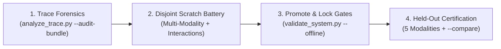

# Empirical Harness Engineering and Contributor Guide

Facet is improved using the same scientific method it enforces on generated code: **diagnose real traces from the current codebase, test general hypotheses in isolated multi-modality scratch batteries, lock proven invariants into deterministic hooks and offline tests, and certify held-out modalities end-to-end before committing**.

This guide documents both the codebase navigation conventions that prevent documentation and comment drift and the reproducible four-step workflow for contributing harness, hook, prompt, or validation improvements.

---

## 1. Navigating the Codebase Without Drift

Agentic repositories face a specific maintenance hazard: AI models routinely paraphrase adjacent syntax into comments (`# Iterate over items in list`) and leave stale rationales behind when editing narrow line windows. When a later agent reads a stale comment, it treats that comment as a ground-truth contract and introduces bugs.

The Facet repository prevents this through five repository-wide rules enforced mechanically by [`validate_system.py`](../scripts/validate_system.py) (`--pathway static`):

1. **Top-of-File `Function Map:` and `Section N:` Anchors + Mandatory `Phases:` Sub-Maps (`> 250` Lines):**
   - Every Python (`.py`) and ES-module (`.mjs`) source file begins with a `Function Map:` in its top docstring or JSDoc header listing numbered responsibilities (`Section 1` .. `Section K`) and the exact primary symbols (`functions`, `classes`, `constants`) defined in each section, deliberately omitting brittle line numbers.
   - Each entry `Section N: <Title>` matches an exact `# Section N: <Title>` (or `// Section N: <Title>`) banner in the file body. Furthermore, every Python function spanning more than `250` lines declares an ordered `Phases:` sub-map in its docstring (`Phase 1` .. `Phase M`) matched 1:1 to `# --- Phase N: <Title> ---` markers inside its AST span. When investigating or editing a module, read lines `1..60` (and the function docstring for large dispatchers) first, then jump directly to the target `Section N:` or `Phase N:` banner with `grep`.
   - Pathway 1 of [`validate_system.py`](../scripts/validate_system.py) parses every file's AST and fails if any `Function Map:` or `Phases:` entry is missing, out of order, missing its body banner, or names a symbol that no longer exists.
2. **Executable Docstring `Args:` / `Raises:` Parity, Backticked Comment Symbol Checks & Single-Source Enums:**
   - Pathway 1 verifies that every parameter listed under `Args:` in a Python docstring exists in that function's `ast.arguments` signature, every exception type listed under `Raises:` resolves to a defined or built-in exception class, and every backticked call reference (`` `helper_name()` ``) in `#` comments resolves to a real symbol in the repository's AST symbol table.
   - Configuration string enums live in single-source tuples and `Literal[...]` type aliases in [`constants_and_context.py`](../.github/hooks/scripts/facet_guards/constants_and_context.py) (`GOVERNANCE_MODES`, `LOCAL_SPEC_CRITIC_MODES`, `EXPERIMENT_ENUM_OPTIONS`) and are checked 1:1 against [`pipeline_config.schema.json`](../.github/skills/spec-pipeline/pipeline_config.schema.json) rather than duplicated in prose comments, avoiding brittle cardinality phrases (such as hardcoded action or stage counts).
3. **Concrete Operational Inline Comments & Coupled-Contract Pointers Only:**
   - Inline comments must describe **operational mechanics that are not obvious from the syntax itself**—wire-protocol quirks (for example, why VS Code's `stop_hook_active` flag stays sticky after the first stop block, or why quoted `python -c '...'` bodies are blanked before scanning for shell `>` redirection), byte-offset invariants, lock-stripe re-entrancy, numerical conditioning bounds, or explicit `Coupled contract:` pointers where two files share a non-import schema boundary (verified in `validate_system.py`).
   - Never add comments that merely restate `for`, `if`, `with`, or `return` syntax, and keep overarching architectural rationale in `docs/` and top-of-file module docstrings rather than inside loop bodies.
4. **Accurate Provenance and Primary-Source Grounding:**
   - Distinguish exact technical standards—such as [RFC 8259](https://www.rfc-editor.org/rfc/rfc8259) JSON, [RFC 6901](https://www.rfc-editor.org/rfc/rfc6901) JSON Pointer, [PEP 508](https://peps.python.org/pep-0508/) dependency specifiers, and FIPS 180-4 SHA-256—from methodologies where Facet intentionally tailors a classical design for local open-weight models, and cite the primary literature directly:
     - **Modular Decomposition & Comment Consistency:** Module boundaries follow information-hiding criteria ([Parnas, 1972](https://doi.org/10.1145/361598.361623)), and removing syntax-paraphrasing comments eliminates a well-documented source of code-comment inconsistency defects ([Tan et al., SOSP 2007](https://doi.org/10.1145/1294261.1294276)).
     - **Two-Phase Cleanroom Isolation & Confinement:** Draws on Cleanroom software engineering's separation of implementation and certification ([Mills, Dyer, & Linger, 1987](https://doi.org/10.1109/MS.1987.231413)) and channel confinement ([Lampson, 1973](https://doi.org/10.1145/362375.362389)), enforced via a finite-state reference monitor ([Schneider, 2000](https://doi.org/10.1145/353323.353382)), while permitting `@Engineer` up to three inline smoke probes and unlocking post-failure source inspection (`two_phase_post_pytest`) so `@Auditor` can isolate minimal counterexamples.
     - **Four-Predicate Verification Taxonomy:** Combines pinned anchor vectors with pseudo-oracle differential testing ([Weyuker, 1982](https://doi.org/10.1093/comjnl/25.4.465); [Zhang et al., 2023](https://arxiv.org/abs/2305.14591)), metamorphic relations ([Chen et al., 1998](https://arxiv.org/abs/2002.12543)), and property-based shrinking ([Claessen & Hughes, 2000](https://doi.org/10.1145/351240.351266); [Hughes, 2020](https://doi.org/10.1007/978-3-030-47147-7_4); [MacIver et al., 2019](https://doi.org/10.21105/joss.01891)).
     - **Transcriptional Uncertainty Markup:** Uses a compact two-element XML vocabulary (`<uncertain>` and `<illegible/>`) modeled on the `<unclear>` and `<gap>` editorial tags of the Text Encoding Initiative ([TEI P5 §3.5.3 & Ch. 12](https://tei-c.org/release/doc/tei-p5-doc/en/html/PH.html#PHDA)) without requiring full TEI document headers.

---

## 2. The Four-Step Empirical Improvement Loop

Avoid tuning prompts or hooks around a single failing paper or benchmark example. Point fixes often mask deeper structural bottlenecks or regress another modality. Follow this four-step loop instead:



### Step 1: 1:1 Trace Forensics on Current-Codebase Runs

Start from a session recorded on the **current codebase** (`HEAD Prompt Parity = Current` in `00_MASTER_AUDIT.md`). Never mix historical traces from older hook or prompt revisions into root-cause statistics.

```bash
# Emit a verbatim 1:1 stage-by-stage audit packet and 6-bucket diagnostic report
./.venv/bin/python scripts/analyze_trace.py --session <session_id_or_events_jsonl> \
  --audit-bundle logs/context_audits/current_baseline
./.venv/bin/python scripts/analyze_trace.py --session <session_id_or_events_jsonl> --diagnose
```

Inspect `00_MASTER_AUDIT.md`, `stages/01..04_*.md`, and `raw/wire_capture.jsonl` to trace symptoms back to their **earliest upstream stage**:
- Did `@Engineer` spend 30 minutes in Stage 3 because of a coding weakness, or because Stage 0V dropped a 1-pixel overbar (`\overline{Z}`) and Stage 1 cryptographically sealed an inconsistent equation into `manifest.json`?
- Did `@Formalist` burn multiple retries in Stage 2 because of reasoning drift, or because a brittle identifier-stem regex rejected an idiomatic Python parameter name (`windows` for `g_\lambda`)?
- Check all six diagnostic buckets (`1_reasoning_bloat` through `6_cleanroom_and_ux_integrity`) in [`scripts/README.md`](../scripts/README.md) to quantify `<|thought|>` bloat, unhydrated `view` calls, hook denials, model swaps, and Cleanroom integrity.

### Step 2: Zero-Repo-Mutation Scratch Batteries Across Multiple Modalities

Before editing any tracked file in the repository, test candidate fixes in an **isolated scratch harness** (for example under a temporary directory or gitignored `logs/` folder) so `git status --short` remains completely clean throughout experimentation:

1. **Materialize Isolated Workspaces (`ws/.github` + Isolated `COPILOT_HOME`):**
   - [`scripts/copilot_sdk_runner.mjs`](../scripts/copilot_sdk_runner.mjs) checks `if (!fs.existsSync(wsGithub))` before symlinking the repository's `.github/`. Copying `.github/` into `ws/.github` (while preserving user `model:` lines from `~/.copilot/agents/*.agent.md`), applying arm-specific patches exclusively inside `ws/.github`, and mirroring `ws/.github` into an isolated `--copilot-home` (rewriting `--scope workspace` to `--scope user` in `pipeline-guards.json`) runs genuine `1:1` `copilot-runtime` + hook sessions with zero repository mutations.
2. **Maintain Strict Train/Test Source Disjointness & Rotate Scratch Challenges Across Waves:**
   - **Rotate development challenges on every new experiment wave:** Repeatedly tuning against the same scratch PDF or benchmark problem causes adaptive overfitting to that development fixture ([Dwork et al., 2015](https://doi.org/10.1126/science.aaa9375)). Draw fresh open-access `CC BY 4.0` arXiv papers, fresh standalone `SciCode` problems, and fresh multi-operator synthetic specifications for each battery rather than recycling prior scratch inputs.
   - Never tune prompts or hooks directly on the five canonical held-out certification inputs ([`examples/magical_mystery/IMG_1598.jpg`](../examples/magical_mystery/IMG_1598.jpg), [`examples/constant_q_transform/2609.29119v1.pdf`](../examples/constant_q_transform/2609.29119v1.pdf), [`examples/mandelbrot_set/`](../examples/mandelbrot_set/), the canonical `web_ideation` barycentric prompt, or `SciCode 19.1`).
   - Build scratch batteries from **disjoint** inputs—such as other open-access `CC BY 4.0` arXiv PDFs, standalone raster equation scans without embedded PDF text, multi-operator numerical specs, and disjoint `SciCode` subproblems (for example `11.1` or `14.1`).
3. **Test Multiple Modalities per Factor AND Combined Interaction Cells:**
   - Evaluate each candidate factor (`Control A` vs. `Candidate B` vs. `Candidate C`) across at least **2–3 distinct input modalities** (for example, a two-column PDF, a zero-text image scan, and a closed-book caller-locked function) to prove graceful degradation when optional signals (like PDF vector streams) are absent.
   - Log **explicit activation counters** in cell telemetry (for example, how many `<vector_glyph_anchor>` blocks or `python -c` sanity probes actually fired in `events.jsonl` / `wire_capture.jsonl`) so a non-firing hook is never mistaken for a neutral experimental result.
   - Always include a **combined integration battery** stacking the winning arms together end-to-end (`S0V -> S5`) and use `analyze_trace.py --factorial-json` to detect antagonistic cross-stage interactions ($I_{AB}$) before promotion.
   - Make battery runners **per-cell checkpoint-resumable** (`results/<battery>/<cell_id>/cell_result.json`) so interrupted shells never lose completed cells.

### Step 3: Promote Proven Winners & Lock Deterministic Offline Gates

Once empirical evidence confirms a clear winner with zero cross-modality regressions:

1. **Prefer Deterministic Hooks Over Prompt Prose:** Enforce invariants in [`facet_guards/`](../.github/hooks/scripts/facet_guards/) (`preToolUse`, `postToolUse`, `subagentStop`) rather than lengthening `.agent.md` prompts, keeping prompts concise and free of conflicting directives.
2. **Propagate Consistently Across Code, Schemas, Docs & User Scope:**
   - Update affected modules (keeping `Function Map:` and `Section N:` banners in sync), JSON schemas, `docs/`, and `scripts/README.md`.
   - Add focused fault-injection and trajectory assertions in [`scripts/validate_system.py`](../scripts/validate_system.py) that would fail without the change.
   - Synchronize `~/.copilot/` (preserving user `model:` tags) and run the full offline validation suite:

```bash
./.venv/bin/python scripts/install_user_level.py
./.venv/bin/python scripts/validate_system.py --offline
```

### Step 4: Held-Out Five-Modality & `SciCode` Certification

Certify the promoted stack out-of-sample across all five canonical modalities (`image`, `pdf`, `spec_bundle`, `web_ideation`, and `closed_book_text` `SciCode 19.1`) and run head-to-head `--compare` non-regression checks against your baseline bundle:

```bash
# Run all 5 held-out live modalities via 1:1 copilot-runtime + loopback wire-tap
FACET_SAVE_AUDIT_BUNDLE_DIR=logs/context_audits/candidate_5modalities \
  ./.venv/bin/python scripts/validate_system.py --pathway live --live-modality all --scicode-step 19.1

# Verify non-regression against baseline trace / audit bundle
./.venv/bin/python scripts/analyze_trace.py \
  --compare logs/context_audits/baseline_5modalities/pdf logs/context_audits/candidate_5modalities/pdf

# Optional: run the 3-arm SciCode quick slice (1.1, 4.1, 19.1 -> 19.2)
./.venv/bin/python benchmarks/run_benchmark.py --split validation --preset quick --arms facet-pipeline
```

Before opening a commit or pull request, confirm that:
- `validate_system.py --offline` passes `100%` across Pathways 1–4,
- `00_MULTIMODAL_SCORECARD.md` reports `5/5 PASS` with `100%` `1:1` event/wire parity and `HEAD Prompt Parity = Current`, and
- `git status --short` contains only intentional, documented changes with zero scratch artifacts left in the workspace root.
