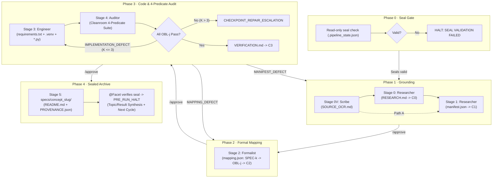

# Facet Usage and Workflow Guide

This guide describes how to run and govern end-to-end engineering tasks with **Facet** in Visual Studio Code.

---

## 1. Initiating a Workflow

In the VS Code Chat panel, select the **Copilot** harness and invoke the `@Facet` agent. `@Facet` is the only agent in the picker; it validates the pipeline's cryptographic seals and then runs the hidden `@Orchestrator` internally.

**Visual Quickstart (`Stage 0V -> Stage 5` via [examples/magical_mystery/IMG_1598.jpg](../examples/magical_mystery/IMG_1598.jpg)):**

```text
@Facet What can you see through your crystalline lens if you peer into the examples folder about the magical mystery image?
```

**Pure-Text Literature Ideation (`Stage 0 -> Stage 5`, Path B):**

```text
@Facet We need to implement and verify the classical Runge-Kutta 4th-order (RK4) numerical ODE integrator from literature.
```

Facet automatically assesses whether the request or workspace `research/` directory includes visual/PDF inputs and routes accordingly:
- **Stage 0V (Conditional Multimodal Pre-Pass):** Whenever `<cwd>/research/` contains PDFs, images, SVGs, or visual HTML—or whenever you supply a local `.pdf`, diagram/equation scan, remote PDF URL, or figure-bearing web document—`@Scribe` (`gemma4:e4b` Vision at `T=0.1`) runs `prepare_visual_sources.py` (`--dir research` or `--pdf`/`--url`, `180 DPI` page plates) and transcribes equations verbatim into `SOURCE_OCR.md` with TEI P5 `<uncertain>` / `<illegible/>` provenance before `@Researcher` runs (enforced deterministically by `preToolUse`).
- **Path A (Concrete Literature Provided):** You supply reference documents in `research/`, a text/LaTeX file, or `SOURCE_OCR.md`. `@Researcher` reads local sources first, supplements via approved `web_fetch` URLs as needed, and proceeds directly to **Stage 1 (Specification Manifest)**.
- **Path B (Grounded Ideation):** You provide an open-ended problem statement or target algorithm name without complete implementation details. `@Researcher` prioritizes Turn-1 internet research across Approved Research Domains (`web_fetch`) at **Stage 0 (Grounded Ideation)**.

---

## 2. The `S0V` + `S0 -> S5` Lifecycle Walkthrough



### Boot: Pre-Run Seal Validation (`@Facet`)
- **Action:** `@Facet` reads `<cwd>/.pipeline_state.json` (and any `upstream_seals` listed in `.pipeline_config.json`) via `view` and only then calls `task(agent_type="Orchestrator")`. The `hypervisor-guard` hook verifies the state seal, approved-checkpoint hashes, upstream `PROVENANCE.json` seals, and the out-of-workspace Shadow Seal Ledger before allowing the call.
- **First cycle:** A signed genesis `PRE_RUN_HALT` state is created automatically.
- **Failure:** `[HYPERVISOR HALT - SEAL VALIDATION FAILED]` names the offending file; use `/reset` or restore the sealed file.

### Stage 0V (Conditional): Multimodal PDF, Diagram & Web-Figure OCR (`@Scribe`)
- **Action:** `@Scribe` executes [prepare_visual_sources.py](../.github/skills/technical-perception/scripts/prepare_visual_sources.py) to rasterize PDF pages at `180 DPI` or extract figure images from approved HTML documents into `.pipeline_scratch/ocr_staging/`, inspects the plates via `view` (images before text), and writes `SOURCE_OCR.md` via atomic `create`.
- **3-Tier TEI P5 Provenance:** Legible math is normalized to clean LaTeX (`0` XML tags); smudged or corrupted glyphs are wrapped in `<uncertain raw="..." guess="..." reason="..." confidence="high|medium|low">guess</uncertain>`; occluded symbols use `<illegible context="..." reason="occluded"/>`.
- **Deliverable:** `SOURCE_OCR.md` (temporary `ocr_staging/` renders are cleaned automatically on stage completion).

### Stage 0 (Path B): Grounded Ideation (`@Researcher`)
- **Action:** `@Researcher` queries approved academic sources (`web_fetch`) or canonical textbooks behind the Vision/PDF Modality Firewall and writes `RESEARCH.md` directly via atomic `create`.
- **Pre-Manifest Contract:** Every candidate must include its canonical reference and governing LaTeX formulation. Incomplete drafts omitting formulas or citations are automatically discarded by `postToolUse`.
- **Deliverable:** `RESEARCH.md`.
- **Gate:** **Checkpoint 0 (`[CHECKPOINT: S0 -> C0]`)**. Reply `/approve` (or `/approve [Algorithm Name]`) to proceed.

### Stage 1: Specification Manifest (`@Researcher`)
- **Action:** `@Researcher` extracts canonical equations (`SPEC-k`), domain variables (with optional `role` and dimensional `unit` annotations), optional caller `target_interface` signatures (including variadic `*args` / `**kwargs`), invariants, and `verification_contract` tolerances into `manifest.json` (`create` once, scoped `edit` on revision, formatted to strict RFC 8259 JSON by `postToolUse`). When `"allow_web_research": false` is configured in `.pipeline_config.json`, `web_fetch` is deterministically blocked and text-only runs skip Stage 0 to enter `STAGE_1_SPECIFICATION` directly.

- **Epistemic Provenance Gate:** If `SOURCE_OCR.md` contains `<uncertain>` or `<illegible/>` tags, `manifest.json` must record them in `ambiguities` and mark affected `SPEC-k` entries `"epistemic_status": "assumption"`.
- **Deliverable:** `manifest.json`.
- **Gate:** **Checkpoint 1 (`[CHECKPOINT: S1 -> C1]`)**. Reply `/approve` to cryptographically seal `manifest.json` and proceed to Stage 2.

### Stage 2: Interface and Obligation Discretization (`@Formalist`)
- **Action:** `@Formalist` reads the sealed `manifest.json` and authors `mapping.json` (`create` once, scoped `edit` / `code_patch.py replace-json` on revision):
  - Specifies `public_interface`: `target_module`, `entrypoints`, typed `parameters` (preserving caller `target_interface` signatures, exact positional parameter names, variadic `*args`/`**kwargs`, and `variables[*].role` input/parameter parity), and `return_type`.
  - Maps theoretical symbols to discrete computational types (`float64`, `complex128`, `NDArray[np.float64]`), checking dimensional `unit` consistency across `manifest.json` and `mapping.json`.
  - Lowers every `SPEC-k` claim into one or more `verification_obligations` (`OBL-j`) across Hughes's 4-predicate basis (`anchor`, `reference_model`, `relational_law`, `postcondition`), compiled via `ast.parse(..., mode="eval")` (`AST-1`) and verified for parameter consistency against `public_interface`.
  - Formulates structural $O(1)$/$O(N)$ precondition assertions (banning $O(N^3)$ decompositions), pinned `anchor_test_cases`, optional `suggested_packages`, and optional `upstream_modules` (`specs/<slug>/` imports verified against `PROVENANCE.json`).
- **Deliverable:** `mapping.json`.
- **Gate:** **Checkpoint 2 (`[CHECKPOINT: S2 -> C2]`)**. Reply `/approve` to seal `mapping.json` and authorize Stage 3.

### Stage 3: Environment Provisioning, Implementation & Smoke Checks (`@Engineer`)
- **Action:** `@Engineer` authors/updates `requirements.txt`, initializes/verifies `./.venv`, installs dependencies, and implements production `*.py` code matching `public_interface` in `mapping.json` (and can adjust `requirements.txt` on the fly during Stage 4 Reflexion repair):
  - Inserts precondition domain assertions at function entries and embeds literature citations (`Implements Eq. (X.Y), Page Z`).
  - Writes modules atomically via `create` (with automatic `SyntaxError` rollback and `ruff format`) or surgical `edit` / `code_patch.py`, and smoke-tests `anchor_test_cases` via `./.venv/bin/python -c "..."`.
- **Deliverables:** `requirements.txt` and production source module (e.g., `rk4_integrator.py`).
- **Transition:** Automated handoff (`[TRANSITION: S3 -> S4]`) to `@Auditor`.

### Stage 4: Cleanroom Verification Audit (`@Auditor`)
- **Action:** `@Auditor` formulates verification scripts (`verify_*.py`) strictly from `manifest.json` and `mapping.json` before inspecting internal code, then evaluates every `OBL-j` across the 4-predicate basis (`anchor`, `reference_model`, `relational_law`, `postcondition`).
- **Outcome A (Pass):** `@Auditor` writes `VERIFICATION.md` directly via atomic `create` (`[CHECKPOINT: S4 -> C3]`).
- **Outcome B (Defect Detected):** `@Auditor` writes `AUDIT_FEEDBACK.json` directly via atomic `create`, triggering bounded Stage 3 self-repair ($K_{\max}=3$).

### Stage 5: Provenance Archival (`pipeline_guards.py`)
- **Action:** Upon user `/approve` at Checkpoint 3, `pipeline_guards.py` moves all verified run deliverables—production source code (`*.py`), `requirements.txt`, specification and audit artifacts (`SOURCE_OCR.md` if present, `RESEARCH.md`, `manifest.json`, `mapping.json`, `VERIFICATION.md`, `verify_*.py`, and `AUDIT_HISTORY.json`)—into `specs/<concept_slug>/`, compiles a self-contained `specs/<concept_slug>/README.md` Engineering Dossier (Mermaid `SPEC -> API -> OBL` graph, display KaTeX equations, API signatures, and SHA-256 ledger), writes `hook_state_snapshot.json`, and seals `PROVENANCE.json` (`status: "VERIFIED_COMPLETE"`, SHA-256 hashes, handshake records, and a composite `seal_sha256`), leaving the workspace root completely clean. It then resets `.pipeline_state.json` to `PRE_RUN_HALT` with `post_archive_halt_latch: true`.

### Return: Archival Verification, Topic-and-Result Synthesis & Cycle-2 Chaining (`@Facet`)
- **Action:** `@Facet` views `.pipeline_state.json` and `specs/<concept_slug>/PROVENANCE.json`, confirms `PRE_RUN_HALT`, `VERIFIED_COMPLETE`, a matching `seal_sha256`, and that every archived artifact hash (including `<target_module>.py`, `requirements.txt`, `verify_*.py`, `README.md`, specifications, and `hook_state_snapshot.json`) matches on disk while the workspace root is clean, then stays parked without calling `task`.
- **Output:** A rich **Topic-and-Result Synthesis** focused on the scientific/mathematical subject, source origin, governing equations (`$$...$$`), verified Python API & design trade-offs, and 4-predicate verification findings (plus any candid self-repair note from `AUDIT_HISTORY.json` and one-command `pytest` snippet—with zero pipeline process log), followed by a `### Where to Take This Next` narrative lead-in and a fenced `@Facet ...` prompt for the next cycle. Referencing any sealed `specs/<prev_slug>/` bundle in a follow-up `@Facet` prompt automatically chains its verified signatures, equations, and provenance digest into the new cycle (`Cycle-2 Chaining`).
- **Failure:** `[HYPERVISOR HALT - ARCHIVAL VERIFICATION FAILED]` if the provenance file is missing, unsealed, or any archived artifact no longer matches.

---

## 3. Contractual Governance Commands

To ensure predictability and prevent conversational ambiguity from triggering state changes, Facet strictly enforces four contractual slash commands:

### The `/approve` Command & Read-Only Checkpoint Q&A
Approval at checkpoints is strictly contractual (`/approve` or `/reset` only):
- Commands accepted: `/approve` or `/approve [target]` (e.g., `/approve manifest`, `/approve mapping`) from a root-origin human turn.
- Every checkpoint Gate Card concludes with: `Ask a question about this stage, reply \`/approve\` to continue, or \`/reset\` to start over.`
- Near-miss typos (`approve/`, `/appove`, `aprove`) or conversational affirmations ("looks good", "yes") resolve instantly with zero tool calls (`<checkpoint_reprompt>`), while genuine questions asked while paused at a checkpoint receive a grounded read-only answer from the pending deliverable followed by the 3-line `Stage X of 4` + `Next:` Gate Card—without advancing `.pipeline_state.json` or invoking subagents.

### The `/status` Command
Inspect the current pipeline stage, active concept, repair counter (`repair_attempts / max_repair_attempts`), and live SHA-256 artifact seals at any time with zero tool calls and zero state mutation:
- Command accepted: `/status` (near-miss typos such as `/stauts` or `status/` are also recognized automatically).
- Returns an instant `<status_pulse>` readout whether `@Facet` is parked in `PRE_RUN_HALT` or paused at a human checkpoint.

### The `/reset` Command
Workspace resets are strictly explicit:
- Command accepted: `/reset`.
- Conversational queries or changes of topic never wipe or reset working files.
- When `/reset` is issued, working artifacts in the root directory are safely archived to `specs/<concept_slug>_interrupted_<timestamp>/` before the root directory is cleared.

### The `/add-source` Command
Research website approvals are managed through a 3-layer domain registry ([approved_sources.json](../.github/hooks/approved_sources.json), `~/.copilot/approved_sources.local.json`, and `approved_research_domains` in `.pipeline_config.json`):
- `/add-source <domain_or_url>`: Normalizes and permanently adds one or more public research domains to `~/.copilot/approved_sources.local.json` so `@Researcher` `web_fetch` calls to that domain (and its subdomains) are auto-approved without confirmation popups.
- `/add-source --workspace <domain_or_url>`: Saves the domain in `<workspace>/.pipeline_config.json` (`approved_research_domains`) for team-shared repository configuration.
- `/add-source` (or `/add-source --list`): Lists all currently active approved research domains.
- Any `web_fetch` targeting a domain outside the approved registry falls back cleanly to VS Code's native interactive `Fetch URL` confirmation card for one-off approval.

---

## 4. Reflexion Self-Repair & Target-Aware Spec Rewind Loop

When `@Auditor` detects a failure during Stage 4 (`VERIFICATION.md` is deterministically rejected if any `OBL-j` is `FAILED` or `CONDITIONAL_PASS`):
1. `@Auditor` writes structured failure diagnostics to `AUDIT_FEEDBACK.json` via atomic `create` (`AUDIT_FEEDBACK.json` is preserved on disk throughout the run and archived as `AUDIT_HISTORY.json` at Stage 5).
2. The hook increments `repair_attempts` and inspects normalized `failure_classification` (preserving **all** workspace files on disk for minimal scoped `edit` / `code_patch.py` replacements):
   - **`IMPLEMENTATION_DEFECT`:** Re-delegates to `@Engineer` (`Stage 3`) with `repair_history` and counterexamples for surgical code repair.
   - **`MAPPING_DEFECT`:** Unseals Checkpoint 2 while keeping `mapping.json`, `<target_module>.py`, `verify_*.py`, and `AUDIT_FEEDBACK.json` on disk, rewinds to `@Formalist` (`Stage 2`) with `<original_user_request>` + `<audit_rewind_feedback>` injected into `modifiedArgs["prompt"]` for a scoped `edit`, and follows the deterministic lifecycle forward.
   - **`MANIFEST_DEFECT`:** Unseals Checkpoints 1 & 2 while keeping `manifest.json`, `mapping.json`, and downstream files on disk, rewinds to `@Researcher` (`Stage 1`) for a scoped `edit`, and follows the deterministic lifecycle forward.
3. Once all obligations pass, `VERIFICATION.md` records a `## Specification & Repair History` section documenting every defect caught and resolved.
4. If `repair_attempts >= max_repair_attempts` (default: 3), the **Reflexion Circuit Breaker** trips (`CHECKPOINT_REPAIR_ESCALATION`) and halts for human guidance.

---

## 4b. Visual Inspection with `Facet Lens` (Copilot Canvas)

When opened as a workspace in Visual Studio Code, Facet includes **Facet Lens** ([extension.mjs](../.github/extensions/facet-lens/extension.mjs)), a Workspace-scoped Copilot Canvas workbench (`id: "facet-pipeline-lens"`) following a **split-view workbench design**: steer and approve stages in Chat while inspecting live artifacts side-by-side at `0` LLM token cost, refreshed instantaneously on every checkpoint transition via loopback SSE (`POST /api/notify`).

- **Opening the Canvas:** Ask `@Facet` to open `Facet Lens` (presenting VS Code's `Ready to Open` Canvas card) or focus a specific tab via `focus_lens_view`.
- **Five Zero-Jitter Interactive Views:**
  1. **`Traceability Graph`:** Modular block-aligned `SPEC-k -> FN-m -> OBL-j` contract DAG; clicking any node isolates its filaments and highlights its corresponding equation, implementation lines, and proof obligation across all tabs.
  2. **`Sources & Formulation`:** Split reader displaying either the Stage 0V optical source plate (`IMG`), the searchable multi-document `research/` corpus (`DIR`, with instant `#corpus-search-input` filtering and `#corpus-pin-btn` excerpt pinning), or `Cited References` (`REF`), paired with rendered KaTeX equations, variable tables, and TEI P5 epistemic status.
  3. **`4-Predicate Proofs`:** Balanced 2x2 cleanroom inspection matrix across `anchor`, `reference_model`, `relational_law`, and `postcondition` obligations, accompanied by a side-by-side **Reflexion & Spec-Rewind Counterexample Inspector** whenever `AUDIT_FEEDBACK.json` or `AUDIT_HISTORY.json` records resolved defects.
  4. **`Implementation`:** Line-numbered `target_module` and `verify_<slug>.py` viewer with bidirectional `# Implements SPEC-k` line highlighting.
  5. **`Sealed Archive`:** Browse every sealed `specs/<slug>/` dossier with live 64-character `PROVENANCE.json` SHA-256 verification.

---

## 5. Troubleshooting Common Issues

### Checkpoint Denial: `[GATEKEEPER CHECKPOINT ACTIVE]`
- **Cause:** `@Orchestrator` attempted to delegate to a worker while an approval checkpoint (`C0`–`C3` or `CHECKPOINT_REPAIR_ESCALATION`) was awaiting user confirmation.
- **Resolution:** Ask a question about this stage, reply `/approve` to continue, or `/reset` to start over.

### Hypervisor Denials: `[HYPERVISOR ...]` and `[LOOP-BACK HALT ACTIVE]`
- **Cause:** `@Facet` called a tool other than `view` or `task` (`[HYPERVISOR READ-ONLY CONFINEMENT]`), invoked `@Orchestrator` before viewing the seals (`[PRE-RUN SEAL CHECK REQUIRED]`), a seal failed validation (`[HYPERVISOR HALT - SEAL VALIDATION FAILED]`), or a new run was attempted right after archival (`[LOOP-BACK HALT ACTIVE]`).
- **Resolution:** Do not retry `task`. Fix or restore the named seal (or `/reset`), or send a new `@Facet` prompt to start the next cycle.

### Vision & PDF Modality Firewall: `[MODALITY FIREWALL]`
- **Cause:** A text-confined reasoning specialist (`@Researcher`, `@Formalist`, `@Engineer`, or `@Auditor`) attempted to call `view` directly on a `.png`, `.jpg`, `.svg`, or `.pdf` file.
- **Resolution:** Visual and PDF files must always be staged and transcribed first by `@Scribe` (`Stage 0V` -> `SOURCE_OCR.md`).

### Scoped Artifact Persistence: `[SCOPED EDIT REQUIRED — PRESERVE EXISTING ARTIFACT]`
- **Cause:** An agent called `create` to overwrite a specification or repaired module that already exists on disk.
- **Resolution:** Deliverables are created once via `create(path, file_text)` and updated thereafter via minimal scoped `edit(path, old_str, new_str)` or `code_patch.py` (`replace-symbol`, `replace-lines`, `replace-json`) so valid upstream/downstream work is preserved.

### Capability Confinement: `[CAPABILITY CONFINEMENT]`
- **Cause:** `@Auditor` attempted to edit production source code, `@Engineer` attempted to edit verification test harnesses, or `@Scribe` attempted to write downstream JSON/code files.
- **Resolution:** Each specialist is confined to its designated stage deliverables (`@Scribe` -> `SOURCE_OCR.md`; `@Researcher` -> `RESEARCH.md`, `manifest.json`; `@Formalist` -> `mapping.json`; `@Engineer` -> `requirements.txt` & production `*.py`; `@Auditor` -> `verify_*.py`, `VERIFICATION.md`, `AUDIT_FEEDBACK.json`).

### Write-Lock Violation: `[WRITE-LOCK VIOLATION]`
- **Cause:** An agent attempted to modify `manifest.json` or `mapping.json` after the deliverable was approved at Checkpoints 1 or 2.
- **Resolution:** Approved specifications are cryptographically sealed. If you require theoretical changes, issue `/reset` or request an amendment explicitly.

### Missing Dependency: `[ERROR] MISSING PYTHON DEPENDENCY`
- **Cause:** A required package is missing from the local virtual environment.
- **Resolution:** Run `./.venv/bin/pip install -r requirements.txt`.

### Stalled Run, Empty Response (`422`), or Deselected `@Facet` Runbook
If a session stalls mid-stage, hits a model error (`quota_exceeded`, `empty_response_422`, `context_overflow`), or loses the `@Facet` picker selection after a VS Code reload/resume:
1. **Inspect Diagnostics on Disk:**
   - Check `<workspace>/.pipeline_state.json` (`current_stage` and `last_incident`).
   - Check `<workspace>/.pipeline_errors.log` for stack-free classified `errorOccurred` entries.
   - Check the latest `~/.copilot/session-state/<session-id>/events.jsonl` tail (last `assistant.message`, `tool.execution_complete`, or `session.usage_record` `inputTokens` vs `num_ctx 131072`).
   - For deep hook-routing verification, launch VS Code / Copilot with `FACET_HOOK_TRACE=1` and inspect `~/.copilot/session-state/hook_trace.jsonl`.
2. **Recover Cleanly Without Losing Approved Stages:**
   - Start a **new** Chat in the **Copilot** harness, select **`@Facet`** in the agent picker, and deliberately select your local Gemma model (a resumed session may deselect `@Facet` back to the default agent, and leaving a cloud model selected will hit local-only coordinator guards).
   - Send `@Facet Continue the active pipeline stage` (or prefix with `@Facet ...` if continuing in an existing chat where the picker was deselected). `facet-prompt` detects `.pipeline_state.json` + `last_incident`, injects `<recovery_notice>`, re-verifies all tamper-evident seals, and relaunches `@Orchestrator` synchronously (`mode="sync"`) from the exact persisted stage.
   - If you prefer to discard in-progress drafts and restart cleanly from `PRE_RUN_HALT`, send `/reset`.
